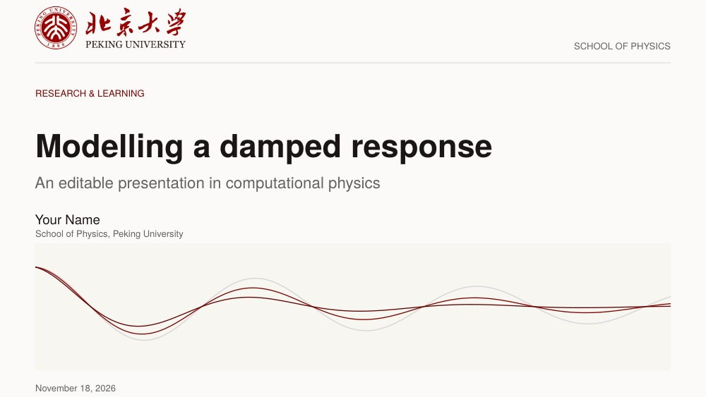

# PKU-beamer

仅包含一套 16:9 Beamer 演示模板，统一封面、页眉页脚、公式、表格、代码与矢量图表的排版。

配色取自网站配色数据中 `source_index: 12` 的方案：米白 `#EDEBDD`、樱桃红 `#810100`、深红 `#630000`、近黑 `#1B1717`。使用中性灰分隔线，浅色背景与红色重点保持一致。该配色是自定义设计，不代表学校官方视觉规范。

[查看完整 PDF](output/beamer.pdf)



## 文件

- `src/beamer/main.tex`：标题、作者、机构、日期等信息。
- `src/beamer/content.tex`：正文示例，包含公式、图表、表格与代码。
- `style/pku-beamer.sty`：演示模板的布局与组件。
- `style/pku.sty`：字体、链接、表格与代码样式。
- `style/pku-palette.sty`：基础色与语义色。
- `style/pku-figures.sty`：PGFPlots 图表与封面矢量装饰。
- `assets/logo.png`：校徽。
- `assets/palette.json`：配色来源与角色快照。
- `output/beamer.pdf`：编译后的七页演示文稿。

图表示例由解析函数生成，不包含实验或模拟数据；请按实际研究内容替换。

## 编译

安装带有 `latexmk`、XeLaTeX、Beamer、xeCJK 和 PGFPlots 的 TeX Live、MacTeX 或 MiKTeX。西文字体使用 TeX Gyre；中文优先使用 Noto CJK 或系统字体，并提供 Fandol 回退。

在此目录执行：

Windows PowerShell：

```powershell
powershell -NoProfile -ExecutionPolicy Bypass -File scripts/build.ps1
```

Linux / macOS：

```bash
bash scripts/build.sh
```

也可使用 `make` 或 `make beamer`。编译结果保存到 `output/beamer.pdf`，临时文件保存在 `scripts/.build/beamer/`。使用 `make clean`（或构建脚本的 `clean` 参数）删除编译产物。

从项目根目录运行构建脚本，它会设置共享样式的搜索路径。图片路径以 `src/beamer/` 为基准，例如 `../../assets/logo.png`。

## 修改

先在 `main.tex` 更新个人信息，再编辑 `content.tex`。图表使用 `pku axis` 样式，数据系列使用统一配色及不同线型、标记，便于黑白阅读。新增图片可以放入 `assets/`。

## 来源与许可

基于 [WestlakeU-LaTeX](https://github.com/kairoswong/WestlakeU-LaTeX) 改编。保留原项目 [LPPL-1.3c 许可证](LICENSE)。
