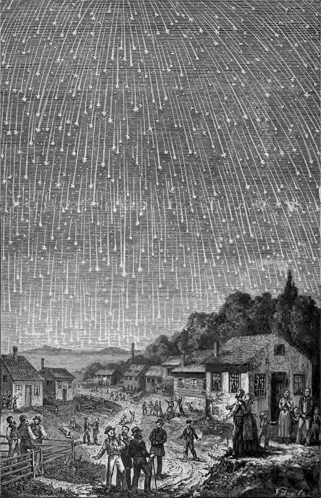
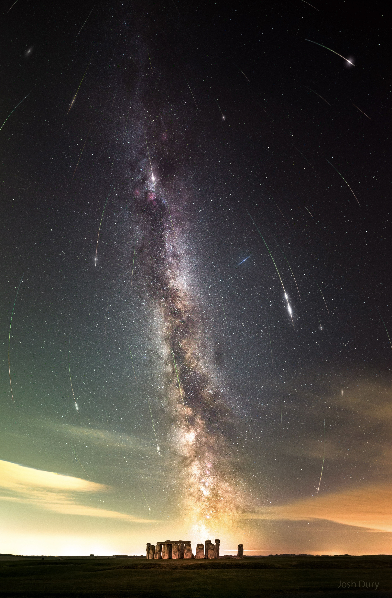
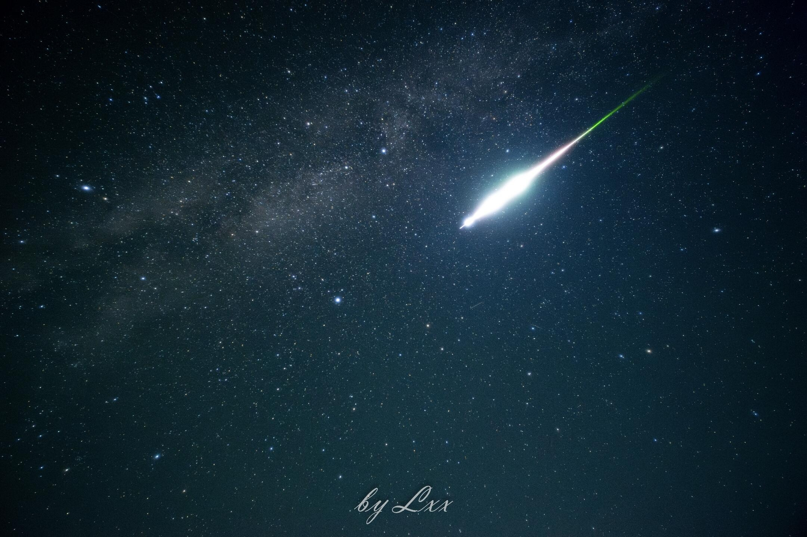
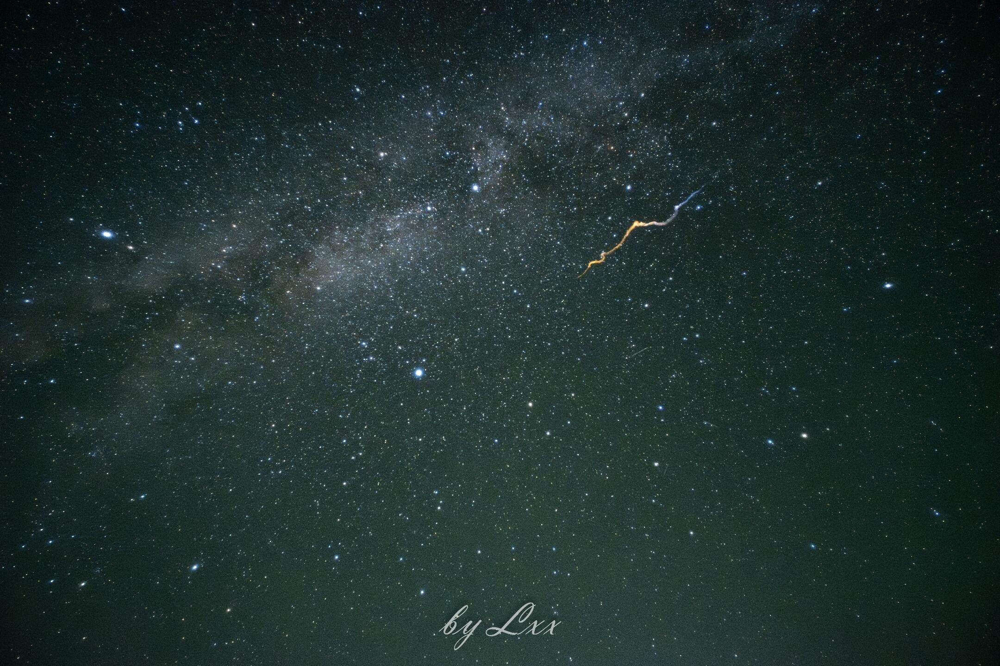
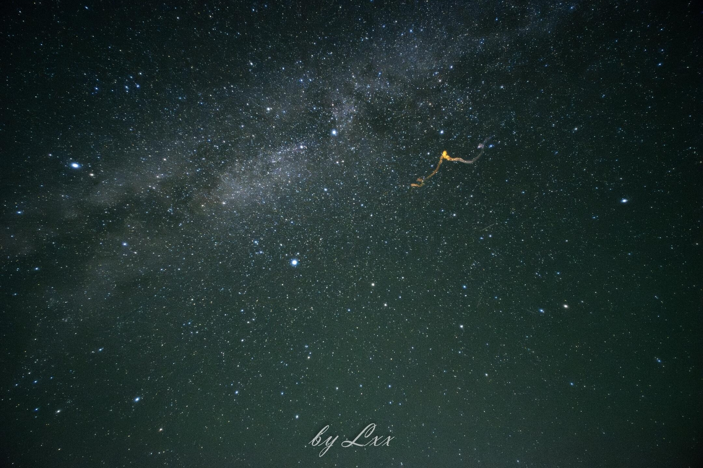

封图为英仙座流星雨。

今日恰逢狮子座流星雨极大，但是北京这天气，也就只能想想了。

传说中，有记录以来最壮观的流星雨，正是发生在 1833年11月13日凌晨的狮子座流星雨。据说高峰时每小时的流量可能达10万颗。

那会是怎样的一幅景象呢？

> 夜中，星落如雨。

不过，普通年份，狮子座流星雨可能每小时只有几颗到十几颗流星。每33年绕太阳运行一圈的 55P/Tempel–Tuttle 是它的母体。只有当地球与其新轨迹擦肩时，也就是每隔约三十年，才能有幸再次感受新的流星雨爆发。

一般年份里，北半球三大流星雨分别是

| Meteor Shower | Annual Peak | ZHR | Parent Body |
|---|---|---:|---|
| Quadrantids | January 3–4 | 120 | (196256) 2003 EH1 |
| Perseids | August 12–13 | 100 | Comet 109P/Swift–Tuttle |
| Geminids | December 13–14 | 150 | (3200) Phaethon |

流星雨们以其辐射点所在的星座命名，本身的产生和星座的星星倒没什么关系。比较特殊的是双子座，它的母体不是彗星，而是小行星3200 Phaethon（法厄同）。

Quadrantids

Perseids

Geminids

相对的，火流星（Fireball）描述的是特别明亮的单颗流星。其不一定来自流星雨，可能只是某位突然的天外来客。

