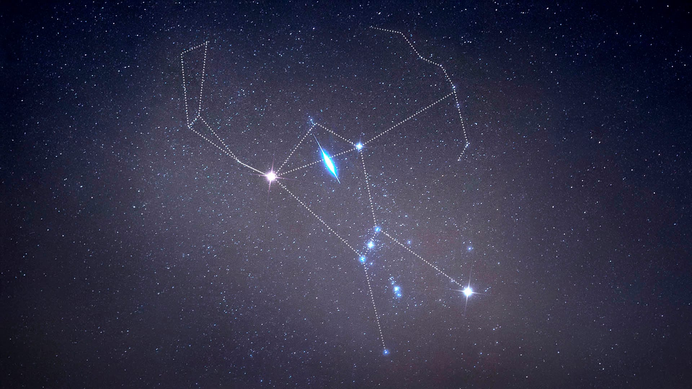
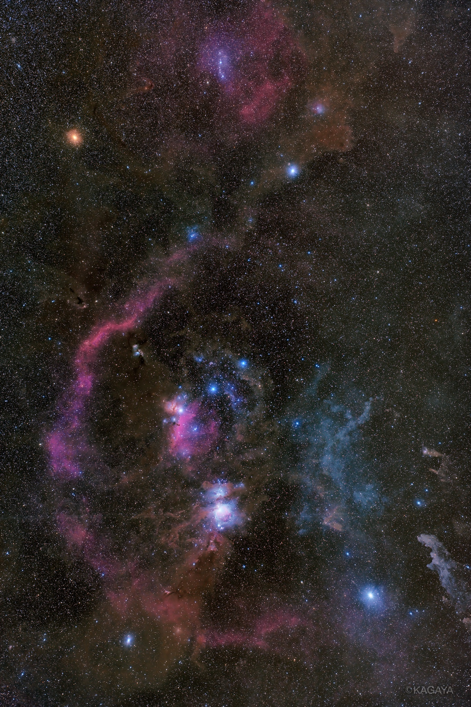
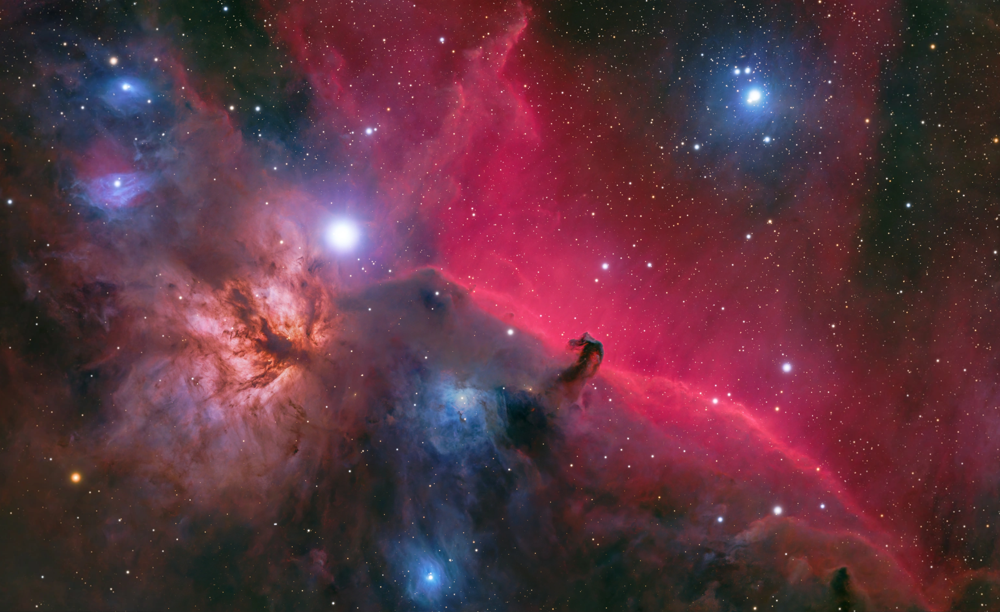
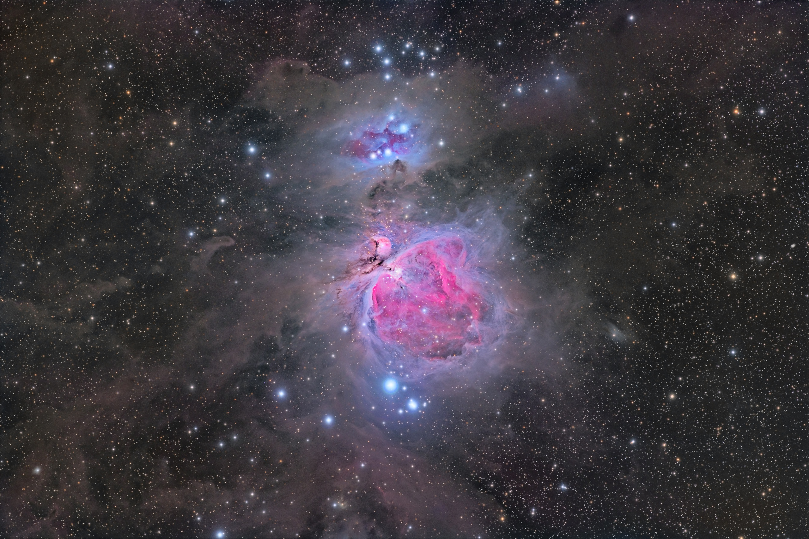
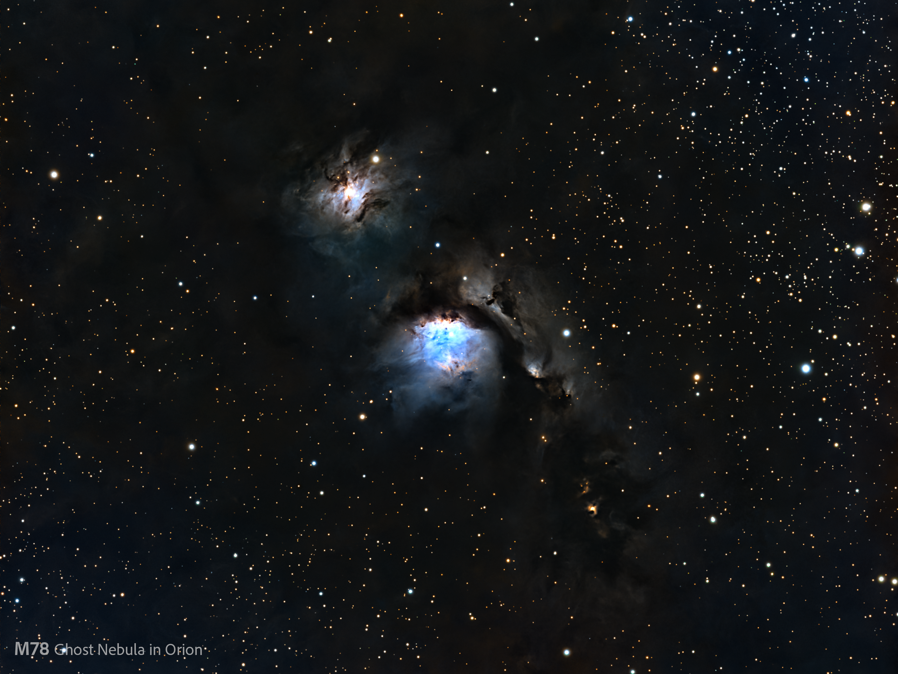
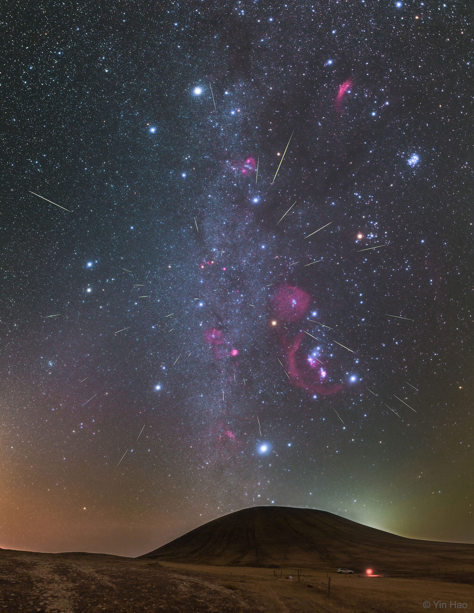

封图为IceCube，位于南极的冰立方天文台。

> “天空中最威严的星座，神话中伟大的猎人。” -- 《夜观星空》

在一众抽象得没边的星座命名里，猎户座应该是形象和名字最为匹配的那一个。任何一个初学者都可以在冬季的晴朗夜空里看到标志性的猎户腰带 —— 由参宿一、参宿二、参宿三组成的明亮三星。古天文视参宿三星为福禄寿的象征，

星座里两颗最明亮的恒星是泛红的参宿四（Orion $\alpha$）和冰蓝的参宿七（Orion $\beta$），分别位于猎人的左肩和右足。另外两颗则是参宿五和参宿六，位于右肩和左足。

参宿四是将死的红超巨星，其亮度经常会发生明显的变化，也因此总有其即将爆发的传言。一部分原因是其自身的脉动，另一个原因则是其伴星的周期性遮挡，不过就亮度而言，大多时候其实还是参宿七更亮。

猎户座的另一个观测亮点就是其深空天体，在深空摄像图中，星云呈现出明显的粉红色，主要来源于$H_{\alpha}$的发射谱线，两个比较明显的集中区域是参宿一附近的火焰星云与马头星云，以及猎户胯部处的猎户座大星云（M42）。另外在深空摄影中清晰可见的还有巴纳德环，它是一个几乎覆盖猎户座尺度的超级大的环形星云，当然尽管长曝光下的环很显眼，但想用肉眼观测到巴纳德环还是有点困难的。

图二为猎户座的深空摄影

图三为火焰星云（NGC 2024，左）与马头星云（IC 434，右），中间的亮星是参宿一。马头星云应该是最有名的一个暗星云，其明亮的粉红色背景被黑暗尘埃遮挡形成鲜明的轮廓，至于像不像马头就比较考验想象力了。

图四为猎户座大星云（M42 / NGC 1976），宛如蝴蝶张开翅膀

另一个小而精致的星云是奥特曼们的故乡，M78星云，它位于参宿一与参宿四的连线上，巴纳德环靠内侧的位置。其形状犹如一双独特的异色瞳。

猎户座流星雨是北半球最有名的几个流星雨之一，活跃于每年的十月。其母体是同样有名的，每76年绕太阳系一圈的哈雷彗星，其下一次回归要等到遥远的2061年。

每年10月，当地球运行到与哈雷彗星遗留尘埃轨道相交的区域时，尘埃落入大气，便形成我们可以看见的明亮流星。其流量在22号左右达到峰值。

猎户座流星雨的辐射点位于参宿四的左上方，下图摄于中国内蒙古乌兰哈达火山。

不过嘛，由于猎户座流星雨的速度很快，所以其实不算观测体验最好的那一档。

传说中，猎人Orion是海神Poseidon之子，有着能在海面行走的才能，他与狩猎女神Artemis相识相知，但这段感情引起了Artemis的兄长，太阳神Apollo的不满。

Apollo设下计谋，诱骗Artemis亲手射杀了Orion，悲痛的Artemis恳请父亲宙斯，将其所爱之人化为星座，永远闪耀于夜空。