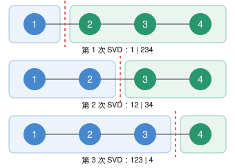
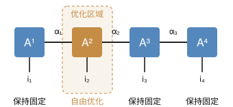
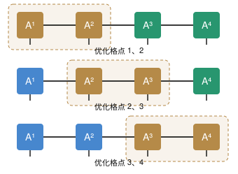

## 1 / 矩阵乘积态MPS

要讲DMRG肯定就得先讲MPS，于是肯定就得先讲Schmidt分解，于是肯定就得先讲SVD。。哦好吧SVD应该不用多讲，就是下面的式子，任意复矩阵 $C$ 都应该可以写成

$$
C=U\Sigma V^\dagger
$$

那么现在考虑两个量子系统 $A$ 和 $B$，复合系统写成$ \mathcal H_{AB}=\mathcal H_A\otimes\mathcal H_B $ ，分别选取两组正交归一基 $ \{|i\rangle_A\}_{i=1}^m$ 和 $\{|j\rangle_B\}_{j=1}^n $

那么对应的任意双体纯态都可以写成

$$
|\psi\rangle_{AB}
=\sum_{i=1}^m\sum_{j=1}^n
c_{ij}|i\rangle_A\otimes|j\rangle_B
$$

$c_{ij}$是复系数，可以整理成一个矩阵

$$
C=
\begin{pmatrix}
c_{11}&c_{12}&\cdots&c_{1n}\\
c_{21}&c_{22}&\cdots&c_{2n}\\
\vdots&\vdots&\ddots&\vdots\\
c_{m1}&c_{m2}&\cdots&c_{mn}
\end{pmatrix}
$$

如果尝试对这个矩阵进行SVD分解，就会有有趣的结果。如下

$$
c_{ij}
=\sum_{k=1}^{r}U_{ik}\sigma_k(V^\dagger)_{kj}.
=\sum_{k=1}^{r}\sigma_k U_{ik}V_{jk}^*
$$

$$
\begin{aligned}
|\psi\rangle_{AB}
&=\sum_{i,j}c_{ij}|i\rangle_A\otimes|j\rangle_B\\
&=\sum_{i,j}\sum_{k=1}^{r}
\sigma_k U_{ik}V_{jk}^*
|i\rangle_A\otimes|j\rangle_B\\
&=\sum_{k=1}^{r}\sigma_k
\left(\sum_i U_{ik}|i\rangle_A\right)
\otimes
\left(\sum_j V_{jk}^*|j\rangle_B\right)
\end{aligned}
$$

如果在这里定义两组新的态矢量，由于$U$、$V$都是酉矩阵，这里相当于选一个新的正交基底

$$
|u_k\rangle_A=\sum_{i=1}^{m}U_{ik}|i\rangle_A
$$

$$
|v_k\rangle_B=\sum_{j=1}^{n}V_{jk}^*|j\rangle_B
$$

那么原量子态就可以在新的基底下写成

$$
|\psi\rangle_{AB}
=\sum_{k=1}^{r}\sigma_k
|u_k\rangle_A\otimes|v_k\rangle_B
$$

以上即为Schmidt分解，$\sigma_k$就是SVD分解出来的奇异值。不难看出分解结果的优势，一个多体的纯态可以在另一套更简洁的基底下完备表示。

可以拿二格点系统做一个简单的例子，选取一个看起来不失一般性的态

$$
|\psi\rangle=\frac{1}{\sqrt7}
(2|00\rangle+|01\rangle+|10\rangle+|11\rangle)
$$

SVG分解结果为

$$
U=V=\frac1{\sqrt{1+\varphi^2}}
\begin{pmatrix}
\varphi&1\\
1&-\varphi
\end{pmatrix}
$$

$$
\Sigma=
\begin{pmatrix}
\sigma_1&0\\
0&\sigma_2
\end{pmatrix}
$$

$$
\varphi=\frac{1+\sqrt5}{2},
\sigma_1=\frac{3+\sqrt5}{2\sqrt7},
\sigma_2=\frac{3-\sqrt5}{2\sqrt7}.
$$

于是有Schmidt分解

$$
|\psi\rangle=
\sigma_1|+\rangle_1|+\rangle_2
+\sigma_2|-\rangle_1|-\rangle_2
$$

$$
|+\rangle=\frac{\varphi|0\rangle+|1\rangle}
{\sqrt{1+\varphi^2}}
$$

$$
|-\rangle=\frac{|0\rangle-\varphi|1\rangle}
{\sqrt{1+\varphi^2}}
$$

以上是偏trivial的结论。废话，，你指望两个格点能玩出什么东西来，我们现在上四个格点的模型，尝试表示其中的一个态，依旧不失一般性，我们写成

$$
|\psi\rangle=
\sum_{i_1,i_2,i_3,i_4=0}^{1}
c_{i_1i_2i_3i_4}
|i_1i_2i_3i_4\rangle
$$

写成矩阵的话$c_{i_1i_2i_3i_4}$会是一个四阶张量。如果仿照前面的做法进行分解，就会发现我们必须要先把系统分成两部分，而对四格点显然有以下的三种方式

分别对应三种 Schmidt 分解，这里用 $\lambda^{[k]}_\alpha$ 表示奇异值

$$
|\psi\rangle=
\sum_{\alpha_1}
\lambda^{[1]}_{\alpha_1}
|L^{[1]}_{\alpha_1}\rangle_1
|R^{[1]}_{\alpha_1}\rangle_{234}.
$$

$$
|\psi\rangle=
\sum_{\alpha_2}
\lambda^{[2]}_{\alpha_2}
|L^{[2]}_{\alpha_2}\rangle_{12}
|R^{[2]}_{\alpha_2}\rangle_{34}.
$$

$$
|\psi\rangle=
\sum_{\alpha_3}
\lambda^{[3]}_{\alpha_3}
|L^{[3]}_{\alpha_3}\rangle_{123}
|R^{[3]}_{\alpha_3}\rangle_4.
$$

当然写出这些东西并不能额外告诉我们什么新的东西，现在一个有趣的想法是把它恢复成原来的样子。假设我们从第三种分割方式出发

$$
|\psi\rangle=
\sum_{\alpha_3}
\lambda^{[3]}_{\alpha_3}
|L^{[3]}_{\alpha_3}\rangle_{123}
|R^{[3]}_{\alpha_3}\rangle_4
$$

此时的右 Schmidt 基矢 $|R^{[3]}_{\alpha_3}\rangle_4$ 由于只包含第四个格点，因此可以直接按格点基底展开

$$
|R^{[3]}_{\alpha_3}\rangle_4
=\sum_{i_4}B^{[4]i_4}_{\alpha_3}|i_4\rangle_4.
$$

$$
|\psi\rangle
=\sum_{\alpha_3}
\lambda^{[3]}_{\alpha_3}
|L^{[3]}_{\alpha_3}\rangle
\left(
\sum_{i_4}B^{[4]i_4}_{\alpha_3}|i_4\rangle
\right)
=\sum_{\alpha_3,i_4}
\lambda^{[3]}_{\alpha_3}
B^{[4]i_4}_{\alpha_3}
|L^{[3]}_{\alpha_3}\rangle|i_4\rangle
=
\sum_{\alpha_3,i_4}
A^{[4]i_4}_{\alpha_3}
|L^{[3]}_{\alpha_3}\rangle_{123}|i_4\rangle_4
$$

这里把系数统一为一个张量$A^{[4]}$，显然这是一个$2\times2$张量。

接下来就需要处理左边的基矢$|L^{[3]}_{\alpha_3}\rangle_{123}$，将它展开到前两个格点的 Schmidt 基底与第三个格点的物理基底构成直积基底 $\left\{
|L^{[2]}_{\alpha_2}\rangle_{12}
\otimes|i_3\rangle_3
\right\}$ 中

$$
|L^{[3]}_{\alpha_3}\rangle_{123}
=\sum_{\alpha_2,i_3}
A^{[3]i_3}_{\alpha_2\alpha_3}
|L^{[2]}_{\alpha_2}\rangle_{12}|i_3\rangle_3
$$

这里$|L^{[2]}_{\alpha_2}\rangle_{12}$是四维矢量，$|i_3\rangle_3$是二维矢量，$\alpha_3$又有两个取值（SVD分解的直接结果，分解的维数等于小的子系统的维数），所以结果就是系数$A^{[3]}$是一个$4\times2\times2$张量。那么于是

$$
|\psi\rangle
={}\sum_{\alpha_3,i_4}
A^{[4]i_4}_{\alpha_3}
\times\left(
\sum_{\alpha_2,i_3}
A^{[3]i_3}_{\alpha_2\alpha_3}
|L^{[2]}_{\alpha_2}\rangle|i_3\rangle
\right)|i_4\rangle
=\sum_{\alpha_2,\alpha_3}
\sum_{i_3,i_4}
A^{[3]i_3}_{\alpha_2\alpha_3}
A^{[4]i_4}_{\alpha_3}
\times|L^{[2]}_{\alpha_2}\rangle_{12}
|i_3i_4\rangle_{34}
$$

接着按照上面的操作处理左基矢，我们最终能得到

$$
|\psi\rangle
=\sum_{i_1,i_2,i_3,i_4}
\sum_{\alpha_1,\alpha_2,\alpha_3}
A^{[1]i_1}_{\alpha_1}
A^{[2]i_2}_{\alpha_1\alpha_2}
A^{[3]i_3}_{\alpha_2\alpha_3}
A^{[4]i_4}_{\alpha_3}
\times|i_1i_2i_3i_4\rangle
$$

对三个虚拟指标的求和其实就是矩阵乘法，也即

$$
|\psi\rangle=\sum_{i_1,i_2,i_3,i_4}
A^{[1]i_1}A^{[2]i_2}A^{[3]i_3}A^{[4]i_4}
\times|i_1i_2i_3i_4\rangle
$$

可以看到，原先纯态的复系数$c_{i_1i_2i_3i_4}$被替换为矩阵乘积的形式。这种表达形式即为矩阵乘积态MPS（Matrix product state, MPS）。

## 2 / 唉，又是变分

那么终于可以开始介绍DMRG，其实很多多体问题的思路归根结底都是变分原理，也就是变成一个能量的全局优化问题。

如果采用一般纯态的写法。对于一个仅仅100个二状态格点的系统，就有$2^{100}$的复参数需要处理。但如果采用MPS态的写法，，，好像也没有变得更好？

废话，恒等变换又不会减少参数量（其实MPS似乎还增加了更多冗余参量）。所以为了能真正进行全局优化的操作，需要进行大家喜闻乐见的截断操作。

根据前面的SVD方法，我们不妨认为截断奇异值较小的部分后依然能保持较高的精度。也就是说我们将在分解的过程中会舍去小奇异值的基底。

还是拿前面的四格点为例，但为了一般性可以不认为每个格点只有两种状态（不妨直接设为$d$维），仍旧从Schmidt 分解出发，假设 Schmidt 系数已经按照从大到小排列

$$
|\psi\rangle=
\sum_{\alpha_3=1}^{d}
\lambda^{[3]}_{\alpha_3}
|L^{[3]}_{\alpha_3}\rangle_{123}
|R^{[3]}_{\alpha_3}\rangle_4.
$$

$$
\lambda^{[3]}_1\geq\lambda^{[3]}_2
\geq\cdots\geq\lambda^{[3]}_{d}>0.
$$

我们只保留前 $D$ 个系数及其对应的基矢，也即（暂时先不归一化）

$$
|\psi^{(3)}\rangle=
\sum_{\alpha_3=1}^{D}
\lambda^{[3]}_{\alpha_3}
|L^{[3]}_{\alpha_3}\rangle
|R^{[3]}_{\alpha_3}\rangle
$$

$$
|\psi^{(3)}\rangle=
\sum_{\alpha_3=1}^{D}\sum_{i_4=1}^{d}
\widetilde A^{[4]i_4}_{\alpha_3}
|L^{[3]}_{\alpha_3}\rangle|i_4\rangle
$$

显然此时的MPS张量$A^{[4]}$也会发生变化，从原先的 $d\times d$ 变为 $d\times D$ 。

接着类似的操作来分解 $|L^{[3]}_{\alpha_3}\rangle (\alpha_3=1,\ldots,D)$，直接的想法是仿照没有截断的思路，将其投影到$\left\{
|L^{[2]}_{\alpha_2}\rangle_{12}
\otimes|i_3\rangle_3
\right\}$ 中。但如果第三个键已经发生了有损截断，那么为了在第二个键上进行当前量子态的最佳 Schmidt 截断，我们需要根据截断结果重新算一次$|L^{[2]}_{\alpha_2}\rangle_{12}$而不是拿着纯态的分解结果直接做。

具体地，我们需要把$|\psi^{(3)}\rangle$先投影到纯态的直积基底，重新算一次SVD分解得到新的$|\bar{L}^{[2]}_{\alpha_2}\rangle_{12}$，而不是直接拿$|L^{[2]}_{\alpha_2}\rangle_{12}$来操作。

> 当然工程上为了效率不一定要到直积基底下做SVD，这里只是提供一个最普适的想法。

那么如果同样截断到$D$阶，可以有

$$
|L^{[3]}_{\alpha_3}\rangle
\approx
\sum_{\alpha_2=1}^{D}\sum_{i_3=1}^{d}
\widetilde A^{[3]i_3}_{\alpha_2\alpha_3}
|\overline L^{[2]}_{\alpha_2}\rangle|i_3\rangle
$$

$A^{[3]}$相应地变成$D\times d\times D$张量

依此类推得到了截断后的MPS态

$$
|\widetilde\psi\rangle
=\sum_{i_1,i_2,i_3,i_4=1}^{d}
\sum_{\alpha_1,\alpha_2,\alpha_3=1}^{D}
\widetilde A^{[1]i_1}_{\alpha_1}
\widetilde A^{[2]i_2}_{\alpha_1\alpha_2}
\widetilde A^{[3]i_3}_{\alpha_2\alpha_3}
\widetilde A^{[4]i_4}_{\alpha_3}
|i_1i_2i_3i_4\rangle
=
\sum_{i_1,i_2,i_3,i_4=1}^{d}
\widetilde A^{[1]i_1}
\widetilde A^{[2]i_2}
\widetilde A^{[3]i_3}
\widetilde A^{[4]i_4}
|i_1i_2i_3i_4\rangle
$$

当然这里不一定每一处都截断到$D$阶，截断阶数总是可以自由选取的，只是为了公式方便这么写而已。

简单估算一下，如果都采用$D$阶截断，原始波函数复杂度大概是$\mathcal O(d^N)$，而截断后的MPS大概是$\mathcal O(NdD^2)$，从指数变成线性，的确是比较明显的优化。当然这种优化很大程度上依赖于我们讨论的一维系统的特殊性，在更高维度MPS的处理就没那么容易了。

以上的连续截断操作等价为，从右往左，每次切割后进行Schmidt分解，舍去小奇异值分量，得到新波函数后再对下一个分割点进行相同操作。理论上你分割顺序想怎么选都行，但按顺序来总是计算上更方便的。

> 至于哪种切割方式相对初态误差最小，那只能说没有标准答案）

不过总之先让我们看看如何对这个截断后的MPS进行全局优化处理，也就是优化下面这玩意

$$
E_D=
\min_{\{A^{[k]}\}}
\frac{\langle\psi_{\mathrm{MPS}}|H|
\psi_{\mathrm{MPS}}\rangle}
{\langle\psi_{\mathrm{MPS}}|
\psi_{\mathrm{MPS}}\rangle}
$$

首先不要考虑最无脑的梯度下降，最显然的思路就是单格点优化。也就是对分解完的MPS态逐一优化MPS张量，直到能量收敛为止。

同样的模型，假设现在只优化第二个格点。固定 $A^{[1]},A^{[3]},A^{[4]}$，将它们分别组成左右有效基底

$$
|L^{[1]}_{\alpha_1}\rangle
=\sum_{i_1}A^{[1]i_1}_{\alpha_1}|i_1\rangle
$$

$$
|R^{[2]}_{\alpha_2}\rangle
=\sum_{i_3,i_4,\alpha_3}
A^{[3]i_3}_{\alpha_2\alpha_3}
A^{[4]i_4}_{\alpha_3}
|i_3i_4\rangle
$$

于是整个MPS态又可以重新写成下面的形式，只显式地保留一个变分的系数$A^{[2]}$

$$
|\psi\rangle=
\sum_{\alpha_1,i_2,\alpha_2}
A^{[2]i_2}_{\alpha_1\alpha_2}
|L^{[1]}_{\alpha_1}\rangle
|i_2\rangle
|R^{[2]}_{\alpha_2}\rangle
$$

代入具体的能量计算（一堆上下标是真折磨）

$$
\langle\psi|H|\psi\rangle
=\sum_{\substack{\alpha_1,i_2,\alpha_2
\beta_1,j_2,\beta_2}}
\left(A^{[2]i_2}_{\alpha_1\alpha_2}\right)^*
\times
\langle L_{\alpha_1},i_2,R_{\alpha_2}|
H
|L_{\beta_1},j_2,R_{\beta_2}\rangle
\times A^{[2]j_2}_{\beta_1\beta_2}
$$

引入$H_{\mathrm{eff}}={}\langle L_{\alpha_1},i_2,R_{\alpha_2}|H|L_{\beta_1},j_2,R_{\beta_2}\rangle$，把$A^{[2]}$当成一个列向量$\mathbf{a}$，那么就是

$$
E=\frac{\mathbf a^\dagger H_{\mathrm{eff}}\mathbf a}
{\mathbf a^\dagger\mathbf a}
$$

根据变分原理，求这玩意的极值等效为求解本征值方程，取最小本征值对应的列向量即可。

$$
H_{\mathrm{eff}}\mathbf a
=E_{\min}\mathbf a
$$

由此得到了修正后的波函数，接下来的操作似乎就是然后按相似的方式继续修复其他的MPS张量。然后就有一个很自然的问题...

那你搞什么SVD不是扯淡吗，我直接初始设一个矩阵形式 $|\psi\rangle=\sum_{i_1,i_2,i_3,i_4}
A^{[1]i_1}A^{[2]i_2}A^{[3]i_3}A^{[4]i_4}
\times|i_1i_2i_3i_4\rangle$ ，初值随便填，然后闭着眼睛优化不就完事了。

其实还真是。如果采用单格点优化，虽然你能用基矢什么的一堆操作看着很厉害糊弄糊弄自己，但说到底就是给定形式下的系数优化问题，跟SVD关系真不大。

所以DMRG的经典处理思路其实是双格点优化法。基本的思路是每次优化相邻两个格点。

无论如何我们再重新写出MPS形式的初态

$$
|\psi\rangle=
\sum_{i_1,i_2,i_3,i_4=1}^{d}
A^{[1]i_1}A^{[2]i_2}
A^{[3]i_3}A^{[4]i_4}
|i_1i_2i_3i_4\rangle
$$

现在来尝试同时优化第二、第三个格点。首先合并两个张量

$$
\Theta^{i_2i_3}_{\alpha_1\alpha_3}
=\sum_{\alpha_2=1}^{D}
A^{[2]i_2}_{\alpha_1\alpha_2}
A^{[3]i_3}_{\alpha_2\alpha_3}.
$$

或者简单一点把合并后的张量记作$M$，此时的维度为

$$
\underbrace{M}_{dD\times dD}
=
\underbrace{A^{[2]}}_{dD\times D}
\underbrace{A^{[3]}}_{D\times dD}
$$

于是每次优化可以将所有 $d^2D^2$ 个元素作为自由变分参数。优化方式和单格点一个道理，但要注意到$M$在优化前是低秩的（由两个低秩矩阵相乘得到），其最大秩为$D$，但是优化后最大能到$dD$，这意味着其在更大的空间中进行优化，得到的结果理应也会更好，不过最终毕竟还得回到相同的子空间。因此单看表达能力二者是相同的，差别在于收敛的速度。

wait，我知道你想说什么，三格点优化乃至多格点当然也是可能的。多格点搜索能力肯定是更强，收敛快慢姑且不谈，但单次计算肯定不会更好算。

另外合并完后肯定得分解，具体做法也是对优化后的合并矩阵进行 SVD

$$
M_{\mathrm{opt}}=U\Sigma V^\dagger
$$

$$
\underbrace{M_{\mathrm{opt}}}_{dD\times dD}
=
\underbrace{U}_{dD\times r}
\underbrace{\Sigma}_{r\times r}
\underbrace{V^\dagger}_{r\times dD}
$$

同样是选取前$D$个奇异值，保证维度一致。优化后的MPS张量可以写为

$$
M_{\mathrm{opt}}\approx
\underbrace{U_D}_{dD\times D}
\underbrace{\Sigma_D}_{D\times D}
\underbrace{V_D^\dagger}_{D\times dD}
$$

$$
A^{[2]}_{\mathrm{new}}=U_D,
\qquad
A^{[3]}_{\mathrm{new}}=\Sigma_DV_D^\dagger
$$

于是其他双格点同理。

所以如果非要从全局优化的视角看，MPS最大的作用应该是提供了一个更有可能逼近基态的拟设形式。其所保留的自由度，恰好符合许多一维（大概也只有一维）量子多体系统基态的纠缠结构。