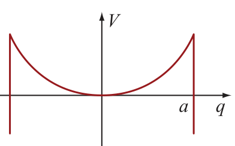
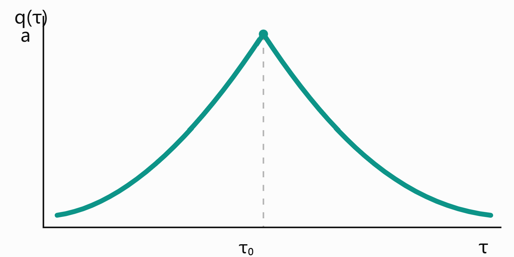

## 1 / Caldeira–Leggett model

参考[上篇笔记](../Instanton/main.md)的内容，亚稳态的隧穿说明了粒子隧穿概率满足指数形式$P_{\mathrm{tun}}\sim e^{-\Gamma_B t/\hbar}$。联想到经典环境下如果有摩擦之类的阻力，粒子跨越势阱会变得困难，这一想法在量子的语境下就应该等效地表达为隧穿概率减小，所以一个自然的猜想就是

$$
P_{\mathrm{tun}}(\eta)
\sim
\exp\left[-\frac{\Gamma_B+\Delta \Gamma_{\mathrm{diss}}}{\hbar}t\right]
$$

$\Delta \Gamma_{\mathrm{diss}}$自然就是来自我们的耗散，它的形式和具体选取的模型有关。但无论如何应该猜想它是个大于0的数。

带耗散的隧穿模型一般把耗散环境建模成无数个与粒子耦合的谐振子，也即Caldeira–Leggett 模型，环境由一组独立谐振子描述，具体来说哈密顿量为

$$
H=\frac{p^2}{2M}+V(q)
+\sum_\alpha\left[
\frac{p_\alpha^2}{2m_\alpha}
+\frac{m_\alpha\omega_\alpha^2}{2}
\left(
x_\alpha-\frac{F_\alpha(q)}{m_\alpha\omega_\alpha^2}
\right)^2
\right]
$$

拆分一下，除了粒子本身的$H_\text{part}$以外，剩下的还有下面几位

$$
H_{\mathrm{bath}}
=
\sum_\alpha
\left[
\frac{p_\alpha^2}{2m_\alpha}
+
\frac12m_\alpha\omega_\alpha^2x_\alpha^2
\right]
$$

振子与粒子的耦合

$$
H_c=-\sum_\alpha F_\alpha(q)x_\alpha
$$

以及一个用来凑个二次形的项

$$
H_{\mathrm{ct}}
=
\sum_\alpha
\frac{F_\alpha(q)^2}
{2m_\alpha\omega_\alpha^2}
$$

总哈密顿量就是$H=H_{\mathrm{part}}+H_{\mathrm{bath}}+H_c+H_{\mathrm{ct}}$，那么接下来就是常规操作了，写出配分函数和作用量什么的，试着来得到一些一般的理论结果，我们有

$$
Z=
\int\mathcal Dq
\prod_\alpha\mathcal Dx_\alpha
\exp\left[
-\frac{S_E[q,\{x_\alpha\}]}{\hbar}
\right]
$$

$$
S_E
=
S_{\mathrm{part,E}}
+
\sum_\alpha S_\alpha
$$

$$
S_\alpha
=
\int_0^{\beta\hbar}d\tau
\bigg[
\frac{m_\alpha}{2}\dot x_\alpha^2
+\frac{m_\alpha\omega_\alpha^2}{2}x_\alpha^2
-F_\alpha(q)x_\alpha
+\frac{F_\alpha(q)^2}
{2m_\alpha\omega_\alpha^2}
\bigg]
$$

这里就可以发现了，我们其实可以把环境作用单独拎出来做个路径积分，变成一个整体的修正。那么来计算一下$S_\alpha$这部分，由于振子的路径满足路径积分的边界条件$x_\alpha(0) = x_\alpha(\beta \hbar)$，因此可以在这个区间内做一个傅里叶变换（$\nu_n=\frac{2\pi n}{\beta\hbar}=\frac{2\pi n k_{\mathrm B}T}{\hbar}$）

一般的应该有

$$
q(\tau)
=
\sum_{n=-\infty}^{\infty}
q_n e^{-i\nu_n\tau}
$$

$$
q_n
=
\frac{1}{\beta\hbar}
\int_0^{\beta\hbar}d\tau\,
q(\tau)e^{i\nu_n\tau}
$$

$$
\int_0^{\beta\hbar}d\tau\,q(\tau)^2
=
\beta\hbar\sum_n|q_n|^2
$$

$$
\int_0^{\beta\hbar}d\tau\,\dot q(\tau)^2
=
\beta\hbar\sum_n\nu_n^2|q_n|^2.
$$

将上面的式子运用到具体要计算的$S_\alpha$上，就是以下

$$
x_\alpha(\tau)
=
\sum_nx_{\alpha n}e^{-i\nu_n\tau}
$$

$$
F_\alpha(q(\tau))
=
\sum_nF_{\alpha n}e^{-i\nu_n\tau}
$$

$$
\int_0^{\beta\hbar}d\tau\,
\dot x_\alpha^2
=
\beta\hbar\sum_n\nu_n^2|x_{\alpha n}|^2
$$

$$
\int_0^{\beta\hbar}d\tau\,
F_\alpha(q)x_\alpha
=
\beta\hbar\sum_n
F_{\alpha,-n}x_{\alpha n},
$$

一番操作得到

$$
S_\alpha
=
\beta\hbar\sum_n
\bigg[
\frac{m_\alpha}{2}
(\nu_n^2+\omega_\alpha^2)
|x_{\alpha n}|^2
-F_{\alpha,-n}x_{\alpha n}
+\frac{|F_{\alpha n}|^2}
{2m_\alpha\omega_\alpha^2}
\bigg]
$$

$$
S_\alpha
={}
\frac{\beta\hbar}{2}
\sum_n
m_\alpha(\nu_n^2+\omega_\alpha^2)
\left|
x_{\alpha n}
-
\frac{F_{\alpha n}}
{m_\alpha(\nu_n^2+\omega_\alpha^2)}
\right|^2
+
\frac{\beta\hbar}{2}
\sum_n|F_{\alpha n}|^2
\left[
\frac{1}{m_\alpha\omega_\alpha^2}
-
\frac{1}{m_\alpha(\omega_\alpha^2+\nu_n^2)}
\right]
$$

这里我们因为是在对环境积分，所以粒子路径$q(\tau)$相当于被冻结，配平方后的第一项，$q(\tau)$在积分后并不会出现，原因是这玩意相当于高斯积分的平移

$$
\int dx\,e^{-A(x-B)^2}
=\sqrt{\frac{\pi}{A}}
$$

那么其贡献的自然就是一个常数项，我们自信扔掉，剩下的有效作用量为

$$
S_{\mathrm{eff}}[q]
={}
S_{\mathrm{part,E}}[q]
+
\frac{\beta\hbar}{2}
\sum_{n,\alpha}
\frac{
\nu_n^2|F_{\alpha n}|^2
}{
m_\alpha\omega_\alpha^2
(\omega_\alpha^2+\nu_n^2)
}
$$

$$
F_{\alpha n}
=
\frac{1}{\beta\hbar}
\int_0^{\beta\hbar}d\tau\,
F_\alpha(q(\tau))e^{i\nu_n\tau}
$$

被我们舍掉的作用量贡献了一个系数

$$
Z=Z_{\mathrm{bath}}^{(0)}
\int\mathcal Dq\,
e^{-S_{\mathrm{eff}}[q]/\hbar}
$$

那么现在又似乎变回了一个独立的粒子系统，环境的影响一部分被扔到系数里，一部分变成等效作用量里的成分，注意到修正项那东西是恒正的，这和前面的讨论一致。

取个简单的线性耦合做做看，$F_\alpha(q)=c_\alpha q$，那么有$F_{\alpha n}=c_\alpha q_n$

$$
S_{\mathrm{diss}}
=
\frac{\beta\hbar}{2}
\sum_n|q_n|^2
\sum_\alpha
\frac{
c_\alpha^2\nu_n^2
}{
m_\alpha\omega_\alpha^2
(\omega_\alpha^2+\nu_n^2)
}
=
\frac{\beta\hbar}{2}
\sum_nD(\nu_n)|q_n|^2.
$$

$$
D(\nu)
=
\sum_\alpha
\frac{
c_\alpha^2\nu^2
}{
m_\alpha\omega_\alpha^2
(\omega_\alpha^2+\nu^2)
}
$$

## 2 / 谱密度

更细致的讨论要引入更细致的条件，显然前面的振子模型自由度太多了，没办法把那么多离散的本征频率引入我们实际求解的模型中。

为此不妨引入谱密度 $J(\omega)$用以替代离散的$\omega_\alpha$，二者的关系如下

$$
J(\omega)
=
\frac{\pi}{2}
\sum_\alpha
\frac{c_\alpha^2}{m_\alpha\omega_\alpha}
\delta(\omega-\omega_\alpha),
\qquad\omega>0.
$$

$$
\frac{c_\alpha^2}{m_\alpha\omega_\alpha}
f(\omega_\alpha)
=
\frac{2}{\pi}
\int_0^\infty d\omega\,
J(\omega)f(\omega).
$$

那么前面的频率核就可以写成积分形式了

$$
D(\nu)
=
\frac{2}{\pi}
\int_0^\infty d\omega\,
\frac{J(\omega)}{\omega}
\frac{\nu^2}{\omega^2+\nu^2}.
$$

定义欧姆耗散形式为$J(\omega)=\eta\omega$

$$
D(\nu)
=
\frac{2\eta}{\pi}
\nu^2
\int_0^\infty
\frac{d\omega}{\omega^2+\nu^2}
=
\frac{2\eta}{\pi}
\nu^2\frac{\pi}{2|\nu|}
=
\eta|\nu|
$$

$$
S_{\mathrm{diss}}
=
\frac{\beta\hbar\eta}{2}
\sum_n|\nu_n||q_n|^2
$$

尽管上面的形式已经足够简洁，不过路径积分毕竟是在时域下做的，我们希望能把作用量中的路径严格表示成时域下的路径形式。这个操作没有想象中这么简单，以下是全推导过程。

令 $b = \beta \hbar$

$$
q(\tau)=\sum_nq_ne^{-i\nu_n\tau}.
$$

$$
\int_0^b d\tau\,
[q(\tau)-q(\tau-s)]^2
=
2b\sum_n|q_n|^2[1-\cos(\nu_ns)].
$$

利用恒等式

$$
|\nu_n|
=
\frac1\pi\int_0^b ds\,
\frac{(\pi/b)^2}{\sin^2(\pi s/b)}
[1-\cos(\nu_ns)].
$$

$$
S_{\mathrm{diss}}
=\frac{b\eta}{2\pi}
\sum_n|q_n|^2
\int_0^b ds\,
\frac{(\pi/b)^2[1-\cos(\nu_ns)]}
{\sin^2(\pi s/b)}
=\frac{\eta}{4\pi}
\int_0^b d\tau\int_0^b ds\,
\frac{(\pi/b)^2[q(\tau)-q(\tau-s)]^2}
{\sin^2(\pi s/b)}.
$$

令 $\tau'=\tau-s$，利用虚时间的周期性，最终得到

$$
S_{\mathrm{diss}}
=
\frac{\eta}{4\pi}
\int_0^{\beta\hbar}d\tau
\int_0^{\beta\hbar}d\tau'\,
\frac{
\left(\frac{\pi}{\beta\hbar}\right)^2
[q(\tau)-q(\tau')]^2
}{
\sin^2\left[\frac{\pi(\tau-\tau')}{\beta\hbar}\right]
}
$$

对于零温极限 $T\to0$

$$
S_{\mathrm{diss}}
=
\frac{\eta}{4\pi}
\int_{-\infty}^{\infty}d\tau\,d\tau'\,
\frac{[q(\tau)-q(\tau')]^2}
{(\tau-\tau')^2}
$$

也就是说环境对于粒子的作用，可以被等效地视作粒子不同时刻路径的相互作用（似乎和BCS理论中的库珀对有点类似）

## e.g.1 / 弱耗散的亚稳态势阱

由此我们可以回头看先前讨论过的bounce解，前面提到无耗散的单bounce作用量为

$$
B_0=\frac8{15}m\omega a^2
$$

如果加上耗散就会产生些许微妙的变化，当然我们这里考虑欧姆谱下的弱耗散（$\frac{\eta}{m\omega}\ll1$）。最直接的想法无疑是对$S_\text{eff}$求个变分得到修正的bounce解，然后再重算一遍作用量。

$$
\frac{\delta S_{\mathrm{eff}}}{\delta x(\tau)}=0
$$

$$
-m\ddot x_b(\tau)
+V'(x_b(\tau))
+
\frac{\eta}{\pi}\operatorname{PV}
\int_{-\infty}^{\infty}d\tau'
\frac{x_b(\tau)-x_b(\tau')}
{(\tau-\tau')^2}
=0
$$

不过这里可以取巧，假设修正bounce解为$x_b$，则有

$$
S_0[x_b]
={}S_0[x_b^{(0)}]
+
\int d\tau
\left.
\frac{\delta S_0}{\delta x(\tau)}
\right|_{x_b^{(0)}}
\delta x_b(\tau)
+O(\eta^2).
=
S_0[x_b]=B_0+O(\eta^2).
$$

另外注意到$S_{\mathrm{diss}}$ 本身就正比于 $\eta$，于是直接一步到位，修正的作用量在一阶修正下不需要额外求一个bounce解

$$
S_{\mathrm{diss}}[x_b]
=
S_{\mathrm{diss}}[x_b^{(0)}]
+O(\eta^2).
$$

$$
B_\eta
=
B_0+\Delta B+O(\eta^2),
$$

$$
\Delta B
=
S_{\mathrm{diss}}[x_b^{(0)}]
\Delta B
=
\frac{\eta}{4\pi}
\int d\tau\,d\tau'
\frac{
[x_b^{(0)}(\tau)-x_b^{(0)}(\tau')]^2
}{
(\tau-\tau')^2
}
$$

代入

$$
x_b^{(0)}(\tau)=
a\,\operatorname{sech}^2
\left[
\frac{\omega}{2}(\tau-\tau_0)
\right]
$$

略去计算过程，得到修正的作用量

$$
\Delta B
=
\frac{8\eta a^2}{\pi^3}
\frac32\zeta(3)
\simeq0.4652\,\eta a^2
$$

$$
B_\eta
\simeq
B_0\left(1+0.8723\frac{\eta}{m\omega}\right)
$$

其直观的物理意义就是耗散带来的隧穿概率的下降。

## e.g.2 / Truncated Harmonic Well

另一个例子是截断谐振子势能，也即

$$
V(q)=
\begin{cases}
\dfrac12m\omega_c^2q^2,& |q|\le a,\\[4pt]
-\infty,& |q|>a.
\end{cases}
$$

选这么个东西的原因当然是因为能算。这一回我们就来真的求解一下严格的耗散bounce方程

$$
\frac{\delta S_{\mathrm{eff}}}{\delta q(\tau)}=0
$$

我们想要的肯定是平庸解$q(\tau)=0$之外的解，因此我们要求要求轨迹在某一个虚时间位置达到边界 $q=a$

于是利用利用拉格朗日乘子 $A$，定义受约束作用量

$$
\widetilde S[q,A]
=
S_{\mathrm{eff}}[q]
-A[q(\tau_0)-a].
$$

对这玩意做变分就可以得到对应的bounce方程

$$
-m\ddot q_B(\tau)
+m\omega_c^2q_B(\tau)
+\frac{\eta}{\pi}\operatorname{PV}
\int_0^{\beta\hbar}d\tau'
\frac{
\left(\frac{\pi}{\beta\hbar}\right)^2
[q_B(\tau)-q_B(\tau')]
}{
\sin^2\left[
\frac{\pi(\tau-\tau')}{\beta\hbar}
\right]
}
=A\delta_\beta(\tau-\tau_0).
$$

显然这个方程看着就难以战胜，我们列出结果就好

$$
q_B(\tau)
=
\frac{a}{\beta\hbar f(T,\eta)}
\sum_{n=-\infty}^{\infty}
\frac{
e^{-i\nu_n(\tau-\tau_0)}
}{
m(\nu_n^2+\omega_c^2)+\eta|\nu_n|
}
$$

$$
S_B(T,\eta)
=
\frac{a^2}{2f(T,\eta)}.
$$

$$
f(T,\eta)
=
\frac{k_{\mathrm B}T}{\hbar}
\sum_{n=-\infty}^{\infty}
\frac1{
m\left[
\left(\frac{2\pi n k_{\mathrm B}T}{\hbar}\right)^2
+\omega_c^2
\right]
+\eta\left|\frac{2\pi n k_{\mathrm B}T}{\hbar}\right|
}.
$$

看着有点恶心其实，现在在一些极限条件下试着讨论这个结果

### 1 // 零温、无耗散

最简单的情况是干脆先不管耗散$T\to0,\eta=0$，有

$$
f(T,0)
=
\frac{k_{\mathrm B}T}{\hbar}\sum_n
\frac1{m(\nu_n^2+\omega_c^2)}
$$

当 $T\to0$ 时

$$
\frac{k_{\mathrm B}T}{\hbar}\sum_n
\longrightarrow
\int_{-\infty}^{\infty}\frac{d\nu}{2\pi}
$$

$$
f(0,0)
=
\frac1{2\pi m}
\int_{-\infty}^{\infty}
\frac{d\nu}{\nu^2+\omega_c^2}
$$

$$
\int_{-\infty}^{\infty}
\frac{d\nu}{\nu^2+\omega_c^2}
=
\frac{\pi}{\omega_c}
$$

$$
f(0,0)=\frac1{2m\omega_c}.
$$

$$
S_B(0,0)=m\omega_ca^2.
$$

$$
\Gamma_0\sim
\exp\left(
-\frac{m\omega_ca^2}{\hbar}
\right)
$$

$$
q_B(\tau)
=
\frac{A}{2\pi m}
\int_{-\infty}^{\infty}d\nu\,
\frac{e^{-i\nu(\tau-\tau_0)}}
{\nu^2+\omega_c^2}.
$$

使用傅里叶积分公式

$$
\int_{-\infty}^{\infty}\frac{d\nu}{2\pi}
\frac{e^{-i\nu s}}{\nu^2+\omega_c^2}
=
\frac{e^{-\omega_c|s|}}{2\omega_c}.
$$

$$
q_B(\tau)
=
\frac{A}{2m\omega_c}
e^{-\omega_c|\tau-\tau_0|}
=
ae^{-\omega_c|\tau-\tau_0|}.
$$

当然以上结论都是比较符合直觉的，包括这个路径长得也和之前势阱的bounce解很相似，区别在于这个解的转折处是尖锐的。原因和我们强行选取的边界有关。

### 2 // 零温、强耗散

那么现在看有耗散的情形

$$
f(0,\eta)
=
\int_{-\infty}^{\infty}
\frac{d\nu}{2\pi}
\frac1{
m(\nu^2+\omega_c^2)+\eta|\nu|}
$$

由于偶函数

$$
f(0,\eta)
=
\frac1\pi
\int_0^\infty d\nu\,
\frac1{m\nu^2+\eta\nu+m\omega_c^2}.
$$

$$
f(0,\eta)
=
\frac1{\pi m}
\int_0^\infty
\frac{d\nu}{
(\nu+\lambda_+)(\nu+\lambda_-)
}
$$

$$
\lambda_\pm
=
\frac{
\gamma\pm\sqrt{\gamma^2-4\omega_c^2}
}{2},

\gamma=\frac{\eta}{m}
$$

$$
f(0,\eta)
=
\frac1{\pi m(\lambda_+-\lambda_-)}
\int_0^\infty d\nu
\left[
\frac1{\nu+\lambda_-}
-\frac1{\nu+\lambda_+}
\right]
$$

$$
f(0,\eta)
=
\frac{
\ln(\lambda_+/\lambda_-)
}{
\pi m(\lambda_+-\lambda_-)
}.
$$

强耗散即过阻尼时，$\eta\gg m\omega_c,
\gamma\gg\omega_c$

$$
\lambda_+
\simeq
\gamma=\frac{\eta}{m},
$$

$$
\lambda_-
\simeq
\frac{\omega_c^2}{\gamma}
=
\frac{m\omega_c^2}{\eta}.
$$

$$
\ln\frac{\lambda_+}{\lambda_-}
\simeq
\ln\left(
\frac{\eta^2}{m^2\omega_c^2}
\right)
=
2\ln\left(
\frac{\eta}{m\omega_c}
\right)
$$

$$
f(0,\eta)
\simeq
\frac2{\pi\eta}
\ln\left(
\frac{\eta}{m\omega_c}
\right).
$$

$$
S_B(0,\eta)
\simeq
\frac{\pi\eta a^2}
{4\ln[\eta/(m\omega_c)]}.
$$

$$
\Gamma
\sim
\exp\left[
-\frac{\pi\eta a^2}
{4\hbar\ln[\eta/(m\omega_c)]}
\right]
$$

与前面无耗散的结果比较，可以清楚地看出耗散带来的隧穿抑制效果。

### 3 // 有限温度、无耗散

有限温度的计算会非常复杂，因此我们这里根据结论分析一下性质即可。

对无耗散情形

$$
S_B(T,0)
=
m\omega_ca^2
\tanh\left(
\frac{\hbar\omega_c}{2k_{\mathrm B}T}
\right).
$$

$$
\Gamma(T,0)
\asymp
\exp\left[
-\frac{m\omega_ca^2}{\hbar}
\tanh\left(
\frac{\hbar\omega_c}{2k_{\mathrm B}T}
\right)
\right].
$$

比较一下前面的零温模型就可以看到温度在这里其实是起到促进隧穿的效果的。事实上可以做一个低温下的展开观察出温度修正项的符号是个负号。

$$
S_B(T,0)
=
m\omega_ca^2
\left[
1-2e^{-\hbar\omega_c/(k_{\mathrm B}T)}
+\cdots
\right].
$$

不过这个东西又是指数小的，因此低温下往往可以忽略。

但这个结论在有耗散时就不正确了。

### 4 // 有限温度、有耗散

有限温度有耗散的解为

$$
S_B(T,\eta)
\simeq{}
m\omega_ca^2
+\frac{\eta a^2}{\pi}
-
\frac{2\pi\eta a^2}{3\omega_c^2}
\left(\frac{k_{\mathrm B}T}{\hbar}\right)^2
$$

这个结果的推导已经使用了弱阻尼和低温近似，注意到这里的温度修正变成了$T^2$，也就是说固定耗散强度时，低温升高会降低 Bounce 作用量，增强逃逸。温度和耗散类似一种竞争关系。

以上。

---
**References**

[1] *Condensed Matter Field Theory* (Alexander Altland, Ben Simons)