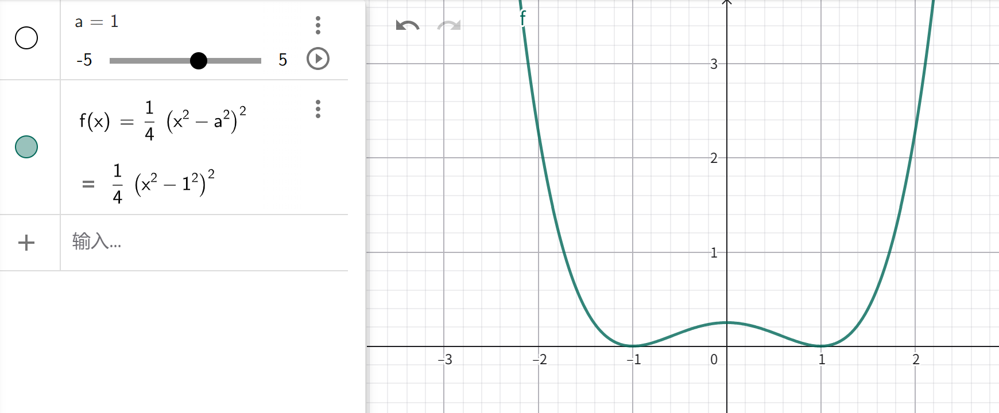
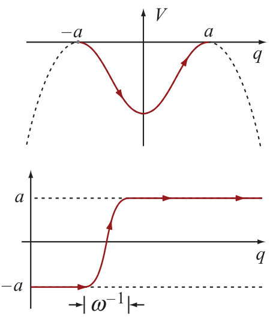
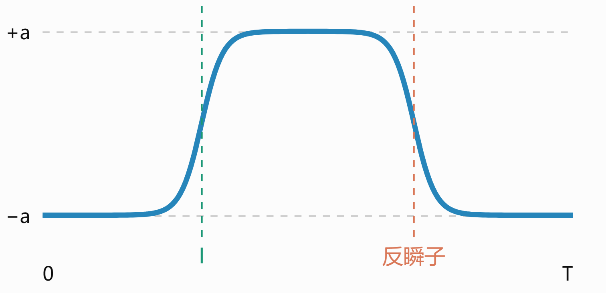
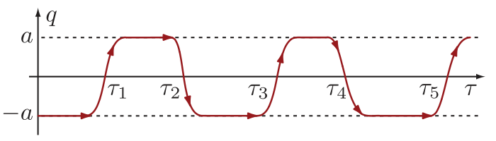
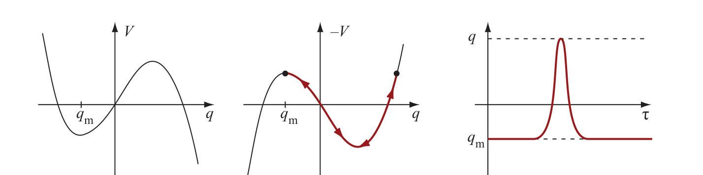
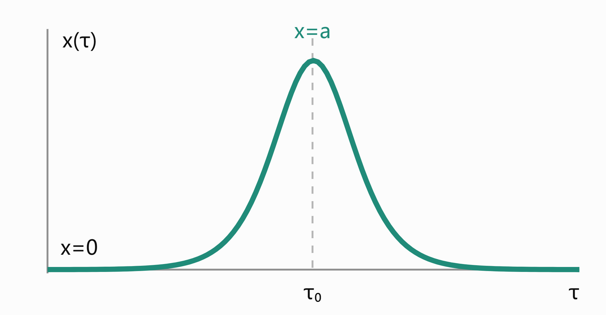
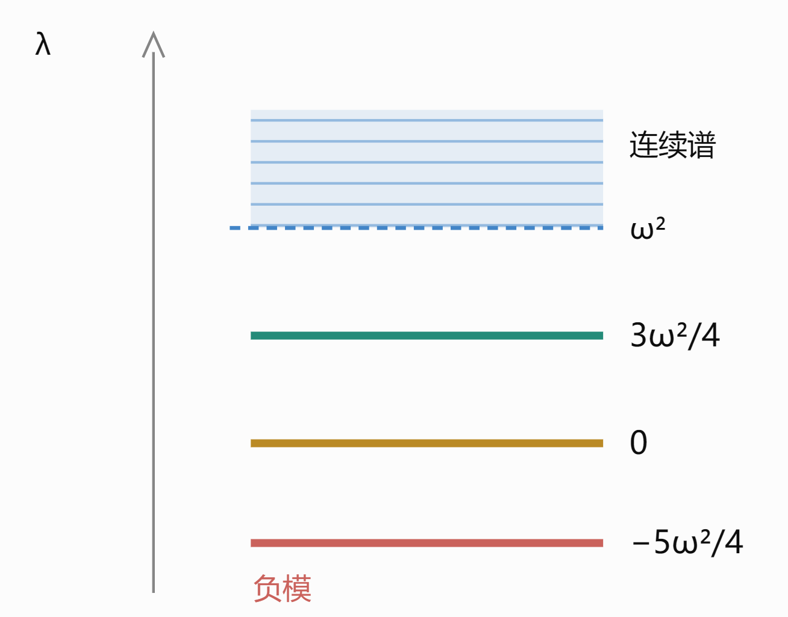

一些路径积分和凝聚态场论的进阶理论，虽然偏冷门知识但感觉挺有意思所以就随便写写

---

## 1 / 路径积分的近似理论

首先，一维的鞍点近似告诉我们，对于下面类型的积分

$$
I(\hbar)=\int_{-\infty}^{\infty}
dx\,g(x)e^{-f(x)/\hbar}
$$

如果能找到 $f(x)$ 在 $x_0$ 处具有非退化的局部极小值

$$
f'(x_0)=0,\qquad f''(x_0)>0
$$

则有近似

$$
I(\hbar)\approx
e^{-f(x_0)/\hbar}
\sqrt{\frac{2\pi\hbar}{f''(x_0)}} g(x_0)
$$

存在多个贡献相近的鞍点那就是

$$
I(\hbar)\sim
\sum_{\alpha}
e^{-f(x_\alpha)/\hbar}
\sqrt{\frac{2\pi\hbar}{f''(x_\alpha)}} g(x_\alpha)
$$

这个结论可以扩展到高维，很自然的想法是把二阶导 $f''(x_\alpha)$ 替换成对应点的Hessian 

$$
I_d(N)=\int_{\mathbb R^d}e^{-f(\mathbf x)/\epsilon}
g(\mathbf x)\,d^d x
$$

$$
I_d(N)\approx
g(\mathbf x_*)e^{-f(\mathbf x_*)/\epsilon}
\left(2\pi \epsilon\right)^{d/2}
\frac1{\sqrt{\det H}}
$$

这个想法倒没什么大问题，对于单一的局部最值是可行的。问题出现在高维时可能有多个函数值一样的极值点，例如函数

$$
f(x,y)=(x^2+y^2-a^2)^2,\qquad a>0
$$

其鞍点不是孤立的，而是构成一个连续流形（Morse–Bott 型临界流形）。换个说法就是Hessian存在零特征值的方向。这个时候需要人为地把这一方向剔除。

当然这个例子可以用极坐标变换轻松解决，我们还是希望找一个更普适的方法。

一般地，设$f$ 在一个光滑、紧致的 $d$ 维流形 $\mathcal M$ 上达到相同的全局极小值 $f_0$。

$$
I(\varepsilon)
=
\int_{\mathbb R^N}d^Nx\,
e^{-f(\mathbf x)/\varepsilon}
$$

可以在这个流形附近选取局部坐标 $\mathbf x=\mathbf x(\boldsymbol\alpha,\boldsymbol\eta)$，其中 $\boldsymbol\alpha=(\alpha_1,\ldots,\alpha_d)$ 描述沿鞍点流形的方向， $\boldsymbol\eta=(\eta_1,\ldots,\eta_{N-d})$ 描述垂直于鞍点流形的方向。假设 Hessian 在全部法向方向上正定，于是可以展开为

$$
f(\boldsymbol\alpha,\boldsymbol\eta)
=
f_0+
\frac12\boldsymbol\eta^T
H_\perp(\boldsymbol\alpha)\boldsymbol\eta
+O(\|\boldsymbol\eta\|^3)
$$

积分于是分为流形空间的积分和法向空间的积分

$$
I(\varepsilon)
\sim
e^{-f_0/\varepsilon}
\int_{\mathcal M}d\mathrm{vol}_{\mathcal M}
\int_{\mathbb R^{N-d}}d^{N-d}\eta\,
e^{-\frac1{2\varepsilon}\eta^TH_\perp\eta}
$$

$$
I(\varepsilon)\sim
e^{-f_0/\varepsilon}
(2\pi\varepsilon)^{(N-d)/2}
\int_{\mathcal M}
\frac{d\mathrm{vol}_{\mathcal M}}
{\sqrt{\det H_\perp(\mathbf x)}}
$$

路径积分实质就是无穷维空间的积分，只不过把无穷维的点写成了路径的形式。自己其实一直觉得路径积分理论有符号滥用的嫌疑，anyway，把路径积分视作高维空间的积分有助于接下来的理解

采用欧式路径积分（进行 $t=-i\tau$ 代换就能变成实时间的路径积分）

$$
K_E(x_f,\tau;x_i,0)
=
\int_{x(0)=x_i}^{x(\tau)=x_f}
\mathcal Dx\,
e^{-S_E[x]/\hbar}
$$

$$
S_E[x]
=
\int d\tau
\left[
\frac m2\left(\frac{dx}{d\tau}\right)^2
+V(x)
\right]
$$

大多路径积分都是很难做的，只有二次型和一些特殊体系可以精确求解。所以照搬前面的鞍点近似理论，假设泛函存在多个驻点（也就是轨道） $x_{\mathrm{cl}}^{(1)}(\tau),
x_{\mathrm{cl}}^{(2)}(\tau),\ldots$，满足

$$
\left.
\frac{\delta S_E}{\delta x(\tau)}
\right|_{x=x_{\mathrm{cl}}^{(\alpha)}}=0
$$

驻点附近进行展开

$$
x(\tau)=x_{\mathrm{cl}}^{(\alpha)}(\tau)+\eta(\tau)
$$

$$
S_E[x]
=
S_E[x_{\mathrm{cl}}^{(\alpha)}]
+
\frac12\langle\eta,\hat K_\alpha\eta\rangle
+O(\eta^3)
$$

Hessian矩阵变算符

$$
\hat K_\alpha
=
-m\frac{d^2}{d\tau^2}
+
V''(x_{\mathrm{cl}}^{(\alpha)}(\tau))
$$

好消息是保留到二阶的话积分就是可做的，得到结果

$$
K_E
\sim
\sum_{\alpha}
\mathcal N_\alpha
\frac{e^{-S_E[x_{\mathrm{cl}}^{(\alpha)}]/\hbar}}
{\sqrt{\det\hat K_\alpha}}
$$

看上去非常完美，如果在谐振子上做这个结果就是完全精确的，因为谐振子没有更高次项，所以为了提升挑战性就不妨看看下面这个模型

## 2 / 双势阱与瞬子

考虑双势阱

$$
V(x)=\frac{\lambda}{4}(x^2-a^2)^2
$$

$$
S_E[x]=\int d\tau
\left[
\frac m2\dot x^2+\frac{\lambda}{4}(x^2-a^2)^2
\right]
$$

试图像波函数理论一样来分析能级，事实上路径积分分析能级和波函数的确不如波函数理论直接，但不妨碍我们理论上能做到这件事，引入正则配分函数

$$
Z(\beta)=\operatorname{Tr}e^{-\beta H}
$$

由谱分解，如果哈密顿量能够量子化，那么应该有能量本征基底下的

$$
Z(\beta)=\sum_ne^{-\beta E_n}
$$

另一方面，注意到位置本征基底下

$$
Z(\beta)
=
\int_{-\infty}^{\infty}dx\,
\langle x|e^{-HT/\hbar}|x\rangle
=
\int_{-\infty}^{\infty}dx\,
K_E(x,\beta\hbar;x,0)
$$

$$
T=\beta\hbar
$$

相当于对所有首尾相接的路径积分，也就是周期欧氏路径积分

$$
Z(\beta)
=
\int_{x(0)=x(\beta\hbar)}
\mathcal Dx\,e^{-S_E[x]/\hbar}
$$

就拿双势阱来分析，先找驻点，EL方程给出（满足边界条件$x(0) = x(T)$）

$$
\left.
\frac{\delta S_E}{\delta x(\tau)}
\right|_{x=x_{\mathrm{cl}}^{(\alpha)}}=0
$$

$$
m\ddot x=\lambda x(x^2-a^2)
$$

其实一眼能看出两个最显然的驻点，也即常数路径

$$
x(\tau)=a
$$

$$
x(\tau)=-a
$$

不妨只在这两个驻点处先展开看看，例如左侧驻点

$$
x(\tau)=-a+\eta(\tau)
$$

$$
S_E[-a+\eta]
=
\frac m2\int_0^T
\eta\left(-\frac{d^2}{d\tau^2}+\omega^2\right)\eta\,d\tau
+O(\eta^3).
$$

$$
\omega=\sqrt{\frac{2\lambda a^2}{m}}
$$

定义真空涨落算符 $\mathcal O_0=-\frac{d^2}{d\tau^2}+\omega^2$，由于这直接就是谐振子的传播核，所以也可以直接解出

$$
Z_L^{(0)}(\beta)
=
\frac1{2\sinh(\beta\hbar\omega/2)}
$$

对应左侧的一堆本征态，同样右侧也有一堆本征态，对应

$$
Z_R^{(0)}(\beta)
=
\frac1{2\sinh(\beta\hbar\omega/2)}
$$

得到了个谐振子能级

$$
Z_{\mathrm{no\ inst}}(\beta)
\approx Z_L^{(0)}+Z_R^{(0)}
=
\frac2{2\sinh(\beta\hbar\omega/2)}
\approx
2\sum_{n=0}^{\infty}
e^{-\beta\hbar\omega(n+1/2)}
$$

$$
\begin{aligned}
E_{0,L}^{\mathrm{loc}}&=E_{0,R}^{\mathrm{loc}}\approx\frac12\hbar\omega\\
E_{1,L}^{\mathrm{loc}}&=E_{1,R}^{\mathrm{loc}}\approx\frac32\hbar\omega\\
&\vdots
\end{aligned}
$$

所以一番近似之后双势阱被搞成两个独立谐振子了。显然是过度近似导致的。

原因也很直接，那就是驻点轨道其实不止这两个常数解，尽管它们的确最显然而且作用量最小（严谨一点，欧式作用量）。但看起来其他驻点还没到可以全部忽略的地步。

先换个边界条件，来看看满足$x(-\infty)=-a,x(\infty)=a$的传播子，相同的EL方程给出不同的解

$$
x_I(\tau;\tau_0)=
a\tanh\left[\frac{\omega}{2}(\tau-\tau_1)\right]
$$

这里称之为瞬子解。类似的有反瞬子

$$
x_{\bar I}(\tau;\tau_2)=
-a\tanh\left[\frac{\omega}{2}(\tau-\tau_2)\right]
$$

构造出来的这个瞬子路径可以试着求出它的作用量，不难求出单瞬子作用量严格解为

$$
S_I
=\int_{-\infty}^{\infty}d\tau
\left[
\frac m2\dot x_I^2+V(x_I)
\right]
=\int_{-\infty}^{\infty}d\tau\,m\dot x_I^2
=\int_{-a}^{a}dx\,\sqrt{2mV(x)}
$$

$$
S_{\bar I}=S_I=\frac23m\omega a^2
$$

因此如果我们求的是边界为$x(-\infty)=-a,x(\infty)=a$的传播子，那么鞍点部分做展开

$$
x(\tau)=x_I(\tau;\tau_0)+\eta(\tau).
$$

$$
S_E[x]
=
S_I+
\frac m2\int d\tau\,
\eta\,\mathcal O_I\eta
+O(\eta^3)
$$

$$
\mathcal O_I
=
-\frac{d^2}{d\tau^2}
+\omega^2
-\frac32\omega^2
\operatorname{sech}^2
\left[\frac{\omega(\tau-\tau_0)}2\right]
$$

这意味着

$$
K_{1I}
=K_E(a,T;-a,0)
\propto
e^{-S_I/\hbar}(\det\mathcal O_I)^{-1/2}.
$$

，，吗？

似乎不完全如此，因为注意到这个驻点存在零模方向，也就是自由参数 $\tau_0$。那么包含零模在内的所有驻点流形的总贡献就可以按照我们先前讨论的方式来操作

把涨落展开为 $\mathcal O_I$ 的本征函数（满足正交归一 $\int d\tau\,\phi_n(\tau)\phi_m(\tau)=\delta_{nm}$），于是非零涨落模式产生一个高斯积分

$$
\eta(\tau)=\sum_n c_n\phi_n(\tau),
\qquad
\mathcal O_I\phi_n=\lambda_n\phi_n.
$$

$$
\sqrt{\frac{m}{2\pi\hbar}}
\int_{-\infty}^{\infty}dc_n\,
e^{-m\lambda_nc_n^2/(2\hbar)}
=
\frac1{\sqrt{\lambda_n}}.
$$

而对于零模方向 $\lambda_0=0$ ，有

$$
\int dc_0\,
e^{-m\lambda_0c_0^2/(2\hbar)}
=
\int dc_0
$$

写出归一化路径的形式

$$
\phi_0(\tau)
=
\sqrt{\frac{m}{S_I}}\dot x_I(\tau)
$$

移动一个无穷小量 $\tau_0\longrightarrow\tau_0+d\tau_0$

$$
dx_I(\tau)
=
\frac{\partial x_I}{\partial\tau_0}d\tau_0
=-\dot x_I(\tau)d\tau_0
$$

另一方面，沿零模方向的涨落为 $dx_I(\tau)=\phi_0(\tau)\,dc_0$，一番比较得到

$$
\phi_0\,dc_0=-\dot x_I\,d\tau_0.
$$

$$
|dc_0|=\sqrt{\frac{S_I}{m}}\,d\tau_0
$$

由此整个积分可解。当然计算算符的本征值也并不简单，但至少是一件思路清晰的事情。这里给出结论（带有$K_{\mathrm{vac}}$是为了消掉路径积分的常数）

$$
\frac{K_{1I}}{K_{\mathrm{vac}}}
\simeq
T\sqrt{\frac{S_I}{2\pi\hbar}}
\left(
\frac{\det\mathcal O_0}
{\det{}'\mathcal O_I}
\right)^{1/2}
e^{-S_I/\hbar}
$$

$$
\frac{K_{1I}}{K_{\mathrm{vac}}}
\simeq
T\sqrt{\frac{S_I}{2\pi\hbar}}
\sqrt{12}\,\omega\,
e^{-S_I/\hbar}[4pt]
=
T\omega
\sqrt{\frac{6S_I}{\pi\hbar}}
e^{-S_I/\hbar}
= \kappa T
$$

其中 $\kappa=
\omega\sqrt{\frac{6S_I}{\pi\hbar}}
e^{-S_I/\hbar}$

那么回到原来的问题，构造瞬子的原因是，容易看出，一个瞬子—反瞬子对构造出来的解可以近似满足EL方程，也就是驻点条件

或者说由其构造的任意偶数次跃迁

但会发现到，例如2次跃迁的瞬子-反瞬子对，其存在两个自由参数$\tau_1$ & $\tau_2$，换言之其Hessian存在零模方向，必须用前面提到的分解空间方式处理。

假设一条周期路径包含 $2k$ 次跃迁，其中心位置为

$$
0<\tau_1<\tau_2<\cdots<\tau_{2k}<T
$$

那么我们构造出来的瞬子对解应该有

$$
S_{2k}\approx2kS_I
$$

另外注意到$2k$个零模方向的积分应该有

$$
\int_{0<\tau_1<\cdots<\tau_n<T}
d\tau_1\cdots d\tau_n
=
\frac{T^n}{n!}
$$

于是直接的结论是 $n$ 个瞬子事件贡献 $\frac{(\kappa T)^n}{n!}$ 这么些量（这里都是相对$K_\text{vac}$ 的值）

于是于是$K_E(-a,T;-a,0)$ 和 $K_E(a,T;a,0)$可求

$$
K_E(-a,T;-a,0)
\simeq
K_\text{vac}(-a,T;-a,0)
\sum_{k=0}^{\infty}
\frac{(\kappa T)^{2k}}{(2k)!}
=
\sqrt{\frac{m\omega}{\pi\hbar}}
e^{-E_{\mathrm{loc}}T/\hbar}
\sum_{k=0}^{\infty}
\frac{(\kappa T)^{2k}}{(2k)!}
$$

$$
K_E(a,T;a,0)
\simeq
K_\text{vac}(a,T;a,0)
\sum_{k=0}^{\infty}
\frac{(\kappa T)^{2k}}{(2k)!}
=
\sqrt{\frac{m\omega}{\pi\hbar}}
e^{-E_{\mathrm{loc}}T/\hbar}
\sum_{k=0}^{\infty}
\frac{(\kappa T)^{2k}}{(2k)!}
$$

具体的配分函数这里需要一点转换，选取局域本征态作为配分函数求迹的基底（只用这俩展开的二维子空间肯定是不充分的，但是求个低能的精细结构够用了）

$$
\langle x|L\rangle = 
\phi_L(x)\approx
\left(\frac{m\omega}{\pi\hbar}\right)^{1/4}
e^{-\frac{m\omega}{2\hbar}(x+a)^2}
$$

$$
\langle x|R\rangle = 
\phi_R(x)\approx
\left(\frac{m\omega}{\pi\hbar}\right)^{1/4}
e^{-\frac{m\omega}{2\hbar}(x-a)^2}
$$

构造低能投影算符 $P_{\mathrm{low}}
=|L\rangle\langle L|+|R\rangle\langle R|$
，于是

$$
\begin{aligned}
Z(T)
&=\int_{-\infty}^{\infty}dx\,K_E(x,T;x,0)\\[6pt]
&\simeq\int_{-\infty}^{\infty}dx\,
\langle x|P_{\mathrm{low}}e^{-HT/\hbar}P_{\mathrm{low}}|x\rangle\\[6pt]
&=\int_{-\infty}^{\infty}dx\,
\Big[
|\phi_L(x)|^2
\langle L|e^{-HT/\hbar}|L\rangle+
|\phi_R(x)|^2
\langle R|e^{-HT/\hbar}|R\rangle+
\phi_L(x)\phi_R^*(x)
\langle L|e^{-HT/\hbar}|R\rangle+
\phi_R(x)\phi_L^*(x)
\langle R|e^{-HT/\hbar}|L\rangle
\Big]\\[6pt]
&=
\underbrace{\int dx\,|\phi_L(x)|^2}_{=1}
\langle L|e^{-HT/\hbar}|L\rangle+
\underbrace{\int dx\,|\phi_R(x)|^2}_{=1}
\langle R|e^{-HT/\hbar}|R\rangle+
\underbrace{\int dx\,\phi_L(x)\phi_R^*(x)}_{=0}
\langle L|e^{-HT/\hbar}|R\rangle+
\underbrace{\int dx\,\phi_R(x)\phi_L^*(x)}_{=0}
\langle R|e^{-HT/\hbar}|L\rangle\\[6pt]
&=
\langle L|e^{-HT/\hbar}|L\rangle
+
\langle R|e^{-HT/\hbar}|R\rangle\\[6pt]
&\simeq
2e^{-E_{\mathrm{loc}}T/\hbar}
\sum_{k=0}^{\infty}
\frac{(\kappa T)^{2k}}{(2k)!}\\[6pt]
&=
2e^{-E_{\mathrm{loc}}T/\hbar}\cosh(\kappa T).
\end{aligned}
$$

逐项比较指数，便得到修正的能级信息

$$
E_0=E_{\mathrm{loc}}-\hbar\kappa
$$

$$
E_1=E_{\mathrm{loc}}+\hbar\kappa
$$

$$
\Delta E=E_1-E_0=2\hbar\kappa=
4\hbar\omega
\sqrt{\frac{m\omega a^2}{\pi\hbar}}
\exp\left(-\frac{2m\omega a^2}{3\hbar}\right)
$$

剩下的令人比较在意的问题就是，我们一开始的要求是所有首尾相连的路径中寻找驻点，而不是预先要求路径从 $-a$ 出发并返回 $-a$，或者从 $+a$ 出发并返回 $+a$。所以比较自然的问题是，为什么我们有理由相信，计算双势阱的能级劈裂时，只需考虑孤立瞬子及其多瞬子组合，而不会遗漏其他可能同样重要的非平凡路径。

这个问题比较合理的解释是，我们选取$2k$次跃迁的瞬子对解不是因为它们的作用量最小，而是因为它们的集体贡献不可忽略。而对于双势阱来说只有真空之间的跃迁存在这种集体结构。

当然作为更直接的数值验证，可以用WKB方法，但这件事情也没有直觉上那么简单，感兴趣的读者不妨自己算算）

如果只是想求一个能级劈裂的话路径积分当然是没有WKB直接的，但这个方法的关键是可以扩展到其他模型

## 3 / 亚稳态势阱与Bounce

考虑一个具有亚稳态的势阱模型，如非对称双势阱，或者一侧无壁的势阱

假设系统最初处于一个局域在亚稳态势阱附近的量子态 $|f\rangle$，近似的就是谐振子的基态

$$
\phi_f(x)=\langle x|f\rangle
\approx
\left(\frac{m\omega}{\pi\hbar}\right)^{1/4}
e^{-m\omega x^2/(2\hbar)}.
$$

符合直觉地，亚稳态的波函数振幅会随着时间应该逐渐跃迁到能量更低的区域，而且存活概率应该近似满足指数衰变规律

$$
\mathcal A_f(t)
=
\langle f|e^{-iHt/\hbar}|f\rangle.
$$

$$
P_f(t)=|\mathcal A_f(t)|^2\simeq e^{-\Gamma t}
$$

$$
\mathcal A_f(t)
\simeq
e^{-iE_0t/\hbar}e^{-\Gamma t/2}.
$$

等价地，可以定义等效能量

$$
E_{\mathrm{eff}}
=
E_0-i\frac{\hbar\Gamma}{2}.
$$

所以形式上我们可以把振幅的衰减等效为能量的虚部，也即 $\Gamma=-\frac{2}{\hbar}\operatorname{Im}E_{\mathrm{eff}}$。转换成路径积分的语言，这不就是形式上求解一下$K_E(x_f,T;x_f,0)$

下面用相似的路径积分方法试着求解具体的模型，我们取右侧有限势垒的

$$
V(x)=
\frac12m\omega^2x^2
\left(1-\frac xa\right).
$$

有驻点 $x_f=0,
x_{\mathrm{top}}=\frac{2a}{3}$，转折点$x_t=a$ 满足 $V(x_t)=V(x_f)=0$

那么依然是装模作样地来求解一下 $K_E(x,T;x,0)$，注意到由于势能形式变了我们没办法使用前面的瞬子对解，但是不妨碍我们得到非常类似的bounce解

$$
m\ddot x=V'(x),
$$

$$
\ddot x=
\omega^2x-
\frac{3\omega^2}{2a}x^2.
$$

$$
x_B(\tau)=
a\,\operatorname{sech}^2
\left[
\frac{\omega}{2}(\tau-\tau_0)
\right]
$$

照搬前面的解法，先看算符的本征谱

$$
x(\tau)=x_B(\tau;\tau_0)+\eta(\tau)
$$

$$
S_E[x]
=
B+
\frac m2\int d\tau\,
\eta(\tau)\mathcal O_B\eta(\tau)
+O(\eta^3)
$$

$$
B=\frac8{15}m\omega a^2
$$

$$
\mathcal O_B
=
-\frac{d^2}{d\tau^2}
+\frac{V''(x_B)}m
=
-\frac{d^2}{d\tau^2}
+\omega^2
-3\omega^2\operatorname{sech}^2
\left[\frac{\omega(\tau-\tau_0)}2\right]
$$

为了严谨一点这边就展示一下求解本征值的方式作为参考，定义 $u=\frac{\omega(\tau-\tau_0)}2$，那么

$$
\mathcal O_B
=
\frac{\omega^2}{4}
\left[
-\frac{d^2}{du^2}
+4-12\operatorname{sech}^2u
\right]
$$

计算本征方程 $A\psi=\lambda\psi$

得到三个离散解和剩下的连续解

$$
\begin{aligned}
\psi_-(u)&\propto\operatorname{sech}^3u,
&\lambda_-&=-\frac54\omega^2,\\[4pt]
\psi_0(u)&\propto\operatorname{sech}^2u\,\tanh u,
&\lambda_0&=0,\\[4pt]
\psi_1(u)&\propto\operatorname{sech}u\,(5\tanh^2u-1),
&\lambda_1&=\frac34\omega^2.
\end{aligned}
$$

$$
\psi(u)\sim e^{iku},
\lambda(k)=\frac{\omega^2}{4}(k^2+4),
\qquad k\in\mathbb R.
$$

会发现这里同样有一个零模，但更关键的是还存在一个负模。负模方向肯定是没法高斯积分的，但倘若我们硬要积分强行代入$\lambda_n^{-1/2}$，其实还真能有形式上的结果，也就是得到一个虚数（尽管目前来看意义不明）

总之我们分解一下作用量进行积分

$$
S_E[x]
=
B+\frac m2
\left(
\lambda_-c_-^2
+\sum_{\lambda_n>0}\lambda_nc_n^2
\right)
+\cdots.
$$

最终求出的单bounce贡献量是（虚数来自负模）

$$
\frac{K^{(1)}(T)}{K^{(0)}(T)}
\simeq
\frac i2
T\sqrt{\frac{B}{2\pi\hbar}}\,
\sqrt{60}\,\omega\,
e^{-B/\hbar}
=
\frac i2\,
\omega T
\sqrt{\frac{30B}{\pi\hbar}}
e^{-B/\hbar}.
$$

与多瞬子对类似的，也要考虑多bounce的贡献，因为每个 Bounce 的权重相同，令 $\Gamma_B=
\omega\sqrt{\frac{30B}{\pi\hbar}}e^{-B/\hbar}$，得到

$$
\begin{aligned}
K^{(n)}(T)
&\simeq
K^{(0)}(T)
\left(\frac{i\Gamma_B}{2}\right)^n
\int_{0<\tau_1<\cdots<\tau_n<T}
d\tau_1\cdots d\tau_n\\
&=
K^{(0)}(T)\frac1{n!}
\left(\frac{i\Gamma_BT}{2}\right)^n.
\end{aligned}
$$

$$
K_{E,f}(x_f,T;x_f,0)
\simeq\sum_{n=0}^\infty K^{(n)}(T)
\simeq
K^{(0)}(T)
\sum_{n=0}^\infty
\frac1{n!}
\left(\frac{i\Gamma_BT}{2}\right)^n
=
K^{(0)}(T)
\exp\left(\frac{i\Gamma_BT}{2}\right).
$$

由于$K^{(0)}(T)$就是最低阶的谐振子近似，也即$K^{(0)}(T)\simeq C e^{-E_0 T/\hbar}$，于是

$$
K_{E,f}(0,T;0,0)
\simeq
C
\exp\left[
-\frac{E_0 T}{\hbar}
+\frac{i\Gamma_BT}{2}
\right]
$$

对比前面的等效能量表达式便可以得到我们要求的衰减率

$$
\begin{aligned}
\Gamma
&\simeq\Gamma_B\\
&=
\omega\sqrt{\frac{30B}{\pi\hbar}}e^{-B/\hbar}\\
&=
4\omega\sqrt{\frac{m\omega a^2}{\pi\hbar}}
\exp\left(
-\frac{8m\omega a^2}{15\hbar}
\right).
\end{aligned}
$$

这件事情就不需要额外引入配分函数的东西，可以直接从传播子得到，算是路径积分能直接应用的一个场景。（非要说的话WKB也能算，但反而不如PI这么自然）

## 4 / 量子场论的fate of the false vacuum

参考Coleman 1977年的论文[@PhysRevD.15.2929]

---
**参考教材**

[1] *Condensed Matter Field Theory* (Alexander Altland, Ben Simons)

[2] *路径积分与量子物理导引* (侯伯元, 云国宏, 杨战营) 