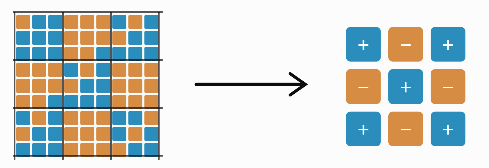

本文主要参考Subir Sachdev 的Quantum Phase Transitions，以及他关于连续量子相变的经典综述 [​Continuous quantum phase transitions](https://link.aps.org/doi/10.1103/RevModPhys.69.315) 

以及PI的[​Quamtum Matter](https://pirsa.org/c25062) 课程，听了前几节感觉挺有收获的，推荐一下

真心喜欢这些理论漂亮的工作，在一众待读列表里简直是清流

---

## 1 / 经典相变理论

以2D Ising为例，经典的相变理论无外乎朗道和平均场近似，最简单的铁磁 Ising 模型的哈密顿量为

$$
H=-J\sum_{\langle i,j\rangle}s_is_j-h\sum_i s_i
$$

随着温度变换会出现有序到无序的转变，具体来说我们可以用平均磁化强度 $m$ 来描述这种无序的程度

$$
m=\frac{1}{N}\sum_i\langle s_i\rangle
$$

朗道的想法是用惊人的注意力注意到既然相变可以用这玩意描述，就把自由能写成它的幂级数展开

$$
f(m,T)=f_0(T)+a_1m+a_2m^2+a_3m^3+a_4m^4+\cdots
$$

这个逆天操作的槽点实在太多而且肯定严格意义上是错的，但不妨碍它能得出一些有趣的结果，所以不妨先看下去，首先不难发现体系满足无磁场下的 $Z_2$ 对称性

$$
H(\{s_i\})=H(\{-s_i\})
$$

所以应该有

$$
f(m,T)=f(-m,T)
$$

这要求自由能只能包含 $m$ 的偶数次幂，在最简单的连续相变情形中，可以忽略六次及更高次项，并引入外磁场的耦合项，有

$$
f(m,T,h)=f_0(T)+\frac{r(T)}{2}m^2+\frac{u}{4}m^4-hm
$$

其中

$$
r(T)=A(T-T_c),\qquad A>0,\quad u>0
$$

这就是用于描述 Ising 相变的四次朗道自由能。平衡态对应于自由能的最小值。对应着求解

$$
\frac{\partial f}{\partial m}=0 \Rightarrow rm+um^3-h=0
$$

$$
m=0
$$

$$
m=\pm\sqrt{-\frac{r}{u}}
$$

即无外磁场下存在两类驻点，后一组解仅在 $r<0$ 时存在。换句话说就是在 $T=T_c$ 处发生相变。注意到

$$
m_{\mathrm{eq}}=\pm\sqrt{\frac{A(T_c-T)}{u}}
$$

因此有幂律关系

$$
m_{\mathrm{sp}}\propto(T_c-T)^{1/2}
$$

说明朗道理论预言磁化强度在接近临界温度时连续趋近于零，这也就是临界相变的特征。当然，由于这个推导太过粗糙，所以求出来的幂律系数也就图一乐。不过虽然自由能的幂律展开式看着很扯淡，但其实其还是有一定道理的，其对应的是平均场近似的结果。

设每个格点有 $z$ 个最近邻自旋，平均磁化强度为 $m$。在平均场近似中，将相邻自旋的相关性近似为

$$
\langle s_i s_j\rangle\approx\langle s_i\rangle\langle s_j\rangle=m^2
$$

那么每个自旋的平均能量为

$$
e(m)=-\frac{zJ}{2}m^2-hm
$$

设向上和向下的自旋分别占比

$$
p_+=\frac{1+m}{2},\qquad p_-=\frac{1-m}{2}
$$

在独立自旋近似下，每个自旋的熵为

$$
s(m)=-k_B\left[p_+\ln p_++p_-\ln p_-\right]
$$

因此自由能

$$
f(m,T)=e(m)-Ts(m)
$$

可以写成

$$
\begin{aligned}
f(m,T,h)={}&-\frac{zJ}{2}m^2-hm\\
&+k_BT\left[\frac{1+m}{2}\ln\frac{1+m}{2}+\frac{1-m}{2}\ln\frac{1-m}{2}\right].
\end{aligned}
$$

简单的泰勒展开可以得到

$$
f(m,T,h)=-k_BT\ln2+\frac{k_BT-zJ}{2}m^2+\frac{k_BT}{12}m^4+\frac{k_BT}{30}m^6+\cdots-hm.
$$

当二次项系数为零时，有

$$
k_BT_c^{\mathrm{MF}}=zJ
$$

这就是平均场理论预言的临界温度。二维对应 $z=4$，也即

$$
k_BT_c^{\mathrm{MF}}=4J
$$

而精确解给出

$$
k_BT_c=\frac{2J}{\ln(1+\sqrt2)}\approx2.269J
$$

差距还是不小，可见平均场实在是过于粗糙的理论。更合理的平均场或许是不对全局求平均，而是求局域的平均，把序参量从单一的参数变成位置的函数

$$
m\longrightarrow m(\mathbf x)
$$

由此可得推广的Landau–Ginzburg理论。其自由能对应的变成了泛函

$$
F[m]=\int d^d x\left[\frac r2m(\mathbf x)^2+\frac u4m(\mathbf x)^4+\frac{\kappa}{2}|\nabla m(\mathbf x)|^2-hm(\mathbf x)\right]
$$

这里 $d$ 是空间维数。会发现这里多了一个修正的梯度项 $\frac\kappa2|\nabla m|^2$，用于一定程度上描述局域磁化在空间中变化所需的自由能代价。但很遗憾这依然是经验公式，并不意味这自由能真就完全写成这个样子。但引入空间变化的好处就在于我们可以在其之上研究一下体系的关联长度。这里定义自旋关联函数来描述位置 $\mathbf x$ 和 $\mathbf y$ 的磁化涨落之间有多大关联。

$$
G(\mathbf x-\mathbf y)=\langle m(\mathbf x)m(\mathbf y)\rangle-\langle m(\mathbf x)\rangle\langle m(\mathbf y)\rangle
$$

进行傅里叶变换：

$$
m(\mathbf x)=\int\frac{d^2q}{(2\pi)^2}m_{\mathbf q}e^{i\mathbf q\cdot\mathbf x}
$$

利用

$$
\nabla m\longleftrightarrow i\mathbf q m_{\mathbf q}
$$

忽略四次项，得到

$$
F_G=\frac12\int\frac{d^2q}{(2\pi)^2}(r+\kappa q^2)|m_{\mathbf q}|^2
$$

利用高斯积分，可以得到动量空间关联函数：

$$
G(\mathbf q)=\frac{k_BT}{r+\kappa q^2}=\frac{k_BT/\kappa}{q^2+\xi^{-2}},
$$

其中

$$
\xi=\sqrt{\frac{\kappa}{r}}
$$

即为特征长度尺度，在平均场近似下

$$
r\propto T-T_c^{\mathrm{MF}}
$$

于是

$$
\xi\propto(T-T_c^{\mathrm{MF}})^{-1/2}
$$

同样的，这里的临界指数也就图一乐。

## 2 / 重整化群（RG）

虽然和接下来要讲的量子相变没啥关系 ，但为了严谨还是写一下处理经典相变相对更准确的方法，大名鼎鼎的RG重整化群理论。

我们先试着把参数无量纲化，写出无磁场下的配分函数

$$
K=\frac{J}{k_BT}
$$

$$
Z=\sum_{\{s_i\}}
\exp\left(K\sum_{\langle i,j\rangle}s_is_j\right)
$$

重整化群可以视作是修正下的平均场近似，所以第一步依然是粗粒化操作，设想将二维区域划分为若干小块。例如可以把每个 $3\times3$ 的自旋块替换为一个新的有效自旋。

也即

$$
S_I=\operatorname{sgn}\left(\sum_{i\in I}s_i\right).
$$

$$
\{s_1,s_2,\ldots,s_N\} \Rightarrow \{S_1,S_2,\ldots,S_{N'}\}
$$

为了使得粗粒化后的系统能够保留原系统的长距离统计性质，肯定不可能依然维持原有的配分函数形式。换句话说我们需要一个等效形式满足粗粒化前后的配分函数完全相等。

$$
e^{-\beta H_{\mathrm{eff}}[S]}
=
\sum_{\{s\}:B[s]=S}e^{-\beta H[s]}.
$$

$$
Z_{\mathrm{eff}}
=\sum_{\{S\}}e^{-\beta H_{\mathrm{eff}}[S]}
=\sum_{\{S\}}
\sum_{\{s\}:B[s]=S}e^{-\beta H[s]}
=\sum_{\{s\}}e^{-\beta H[s]}
= Z
$$

如果我们关心的可观测量$O(S)$刚好是构形的函数，那么在有效体系中应该有块自旋变量的统计预测与在原始微观体系中直接测量相同块变量的结果完全相同。

$$
\langle O(S)\rangle_{\mathrm{eff}}
=
\frac1Z
\sum_S O(S)e^{-\beta H_{\mathrm{eff}}[S]}
=
\frac1Z\sum_s O(B[s])e^{-\beta H[s]}
$$

此时的相互作用可以展开写成长程多关联的形式

$$
-\frac{H'}{k_BT}
={}K_1'\sum_{\langle I,J\rangle}S_IS_J
+K_2'\sum_{\langle\langle I,J\rangle\rangle}S_IS_J
+K_4'\sum_{\square}S_IS_JS_KS_L+\cdots.
$$

换个视角看，RG变化其实就是关联系数的变换

$$
\mathbf K=(K_1,K_2,K_3,\ldots).
$$

$$
\mathbf K'=\mathcal R_b(\mathbf K).
$$

$$
\mathbf K^{(0)}
\longrightarrow
\mathbf K^{(1)}
\longrightarrow
\mathbf K^{(2)}
\longrightarrow\cdots.
$$

每一步都意味着以更大的长度尺度观察系统。而在临界点处的关联体系由于特殊的标度不变性，可预测的，应该存在RG变换的不动点$K^*$

$$
\mathcal R_b(\mathbf K^*)=\mathbf K^*,
$$

而对于偏离临界面的初始点$(K,0,0,...)$，同样可预测的，整个构形会变成强有序构形或者纯无序构形。耦合参数也会流向高温和低温的极限。

不妨试着在临界点附近进行分析，假设一个系统处于临界固定点附近，其耦合常数为
$$
\mathbf K=\mathbf K^*+\delta\mathbf K.
$$

经过一次尺度因子为 $b$ 的 RG 变换

$$
\mathbf K'=\mathcal R_b(\mathbf K)
$$

在固定点附近，尽管RG变换本身是非线性变换，但小量下依然可以将 RG 变换线性展开

$$
\delta K_i'
=
\sum_j
\left.
\frac{\partial\mathcal R_i}{\partial K_j}
\right|_{\mathbf K^*}
\delta K_j.
$$

写成矩阵形式
$$
\delta\mathbf K'=M\delta\mathbf K.
$$

进行喜闻乐见的对角化，找到一组独立的扰动方向 $g_i$，把本征值记作$b^{y_i}$的形式方便后面的讨论，$b$是每次粗粒化的长度尺度
$$
g_i'=b^{y_i}g_i.
$$

把$y_i>0$的方向记作relevant，$y_i<0$记作irrelevant，显然偏离临界点的发散就来源于relevant方向的发散。

RG的视角下同样可以引入关联长度的概念，注意到每次粗粒化的操作。假设初始偏离为

$$
(K_c+A(T-T_c),0,0,...)
$$

其在relevant分量的投影肯定也是正比于$t=\frac{T-T_c}{T_c}$，不妨只考虑投影中本征值最大的方向也就是最relevant的方向（其产生的偏移放大最显著），如果进行 $n$ 次粗粒化，就得到
$$
t_n=b^{ny_t}t.
$$

认为$|t_{n_*}|\sim1$表示系统明显发生偏移，对应的RG尺度即为关联长度

$$
\xi\sim b^{n_*}.
$$

$$
\xi\sim|t|^{-1/y_t}.
$$

以上属于直观的理解视角，但实际去计算$y_t$这类指数是困难的，离散的构形相互作用并不适合具体的计算。但取个巧我们可以采用 Landau-Ginzburg-Wilson 作用量来进行计算，把构形替换成序参量分布$\phi$

$$
S[\phi]
=
\int d^dx
\left[
\frac12(\nabla\phi)^2
+\frac r2\phi^2
+\frac u{4!}\phi^4
\right]
$$

$$
Z=\int\mathcal D\phi\,e^{-S[\phi]}.
$$

然后在这个框架之下进行RG操作，构形的粗粒化等效为对短波分量的积分，先将序参量场做 Fourier 展开（用晶格间距$a$做一个cutoff）

$$
\phi(x)
=
\int_{|k|<\Lambda}
\frac{d^dk}{(2\pi)^d}
e^{ik\cdot x}\phi(k).
$$

$$
\Lambda\sim\frac1a.
$$

进行长短波的拆分

$$
\phi(x)=\phi_<(x)+\phi_>(x).
$$

$$
\phi_<(x)
=
\int_{|k|<\Lambda/b}
\frac{d^dk}{(2\pi)^d}
e^{ikx}\phi(k),
$$

$$
\phi_>(x)
=
\int_{\Lambda/b<|k|<\Lambda}
\frac{d^dk}{(2\pi)^d}
e^{ikx}\phi(k).
$$

则之前关于RG的讨论完全可以类比下来，配分函数可以改写成只包含慢模式的配分函数

$$
Z
=
\int\mathcal D\phi_<\mathcal D\phi_>
e^{-S[\phi_<+\phi_>]}.
$$

$$
Z
=
\int\mathcal D\phi_<
\left[
\int\mathcal D\phi_>
e^{-S[\phi_<+\phi_>]}
\right].
$$

$$
e^{-S_{\mathrm{eff}}[\phi_<]}
=
\int\mathcal D\phi_>
e^{-S[\phi_<+\phi_>]}.
$$

$$
Z
=
\int\mathcal D\phi_<
e^{-S_{\mathrm{eff}}[\phi_<]}.
$$

看上去似乎很完美，但其实还是有问题的，因为我们的展开并不见的完备，具体地说，作用量不见得可以只用$(\nabla\phi)$、$\phi^2$、$\phi^4$这三项表示，对表示空间的截断显然会带来问题。但没办法，我们只能在截断空间中进行计算。

定义 Gaussian 平均

$$
\langle F[\phi_>]\rangle_>
=
\frac{
\int\mathcal D\phi_>\,
F[\phi_>]e^{-S_0[\phi_>]}}
{\int\mathcal D\phi_>\,e^{-S_0[\phi_>]}}.
$$

由 Gaussian action

$$
\langle\phi_>(k)\phi_>(-k)\rangle_>
=
\frac1{k^2+r}
$$

因此在同一空间点

$$
\langle\phi_>^2(x)\rangle_>
=
\int_{\Lambda/b<|k|<\Lambda}
\frac{d^dk}{(2\pi)^d}
\frac1{k^2+r}.
$$

现在来计算单次RG下的系数变换$(r,u)\rightarrow (r',u')$，将 action 分成$S=S_0+S_{\rm int}$

$$
S_0=
\frac12
\int d^dx
\left[
(\nabla\phi)^2+r\phi^2
\right],
$$

$$
S_{\rm int}
=
\frac u{4!}\int d^dx\,\phi^4.
$$

$S_0$本身可以精确求解且对应的不动点$r=0$几乎是显然的，这里懒得写了。关键在于$\phi^4$项，展开

$$
(\phi_<+\phi_>)^4
=
\phi_<^4
+4\phi_<^3\phi_>
+6\phi_<^2\phi_>^2
+4\phi_<\phi_>^3
+\phi_>^4.
$$

省略积分过程直接给出

$$
r_{\rm eff}
=
r+\frac u2 I_1+\cdots,
$$

$$
u_{\rm eff}
=
u-\frac32u^2 I_2+\cdots.
$$

$$
I_1
=
\int_{\Lambda/b<|k|<\Lambda}
\frac{d^dk}{(2\pi)^d}
\frac1{k^2+r}.
$$

$$
I_2=
\int_{\Lambda/b<|k|<\Lambda}
\frac{d^dk}{(2\pi)^d}
\frac1{(k^2+r)^2}.
$$

rescaling后给出最终结果

$$
r'
=
b^2
\left(r+\frac u2I_1+\cdots\right).
$$

$$
u'
=
b^{4-d}
\left(u-\frac32u^2I_2+\cdots\right).
$$

为了普适性我们希望把这个变换连续化，也就是把离散的RG变换变成多个$b\rightarrow1$，记$b=e^{d\ell}$，那么

那么

$$
I_1
\simeq
A_d\frac{\Lambda^d}{\Lambda^2+r}\,d\ell,
$$

$$
I_2
\simeq
A_d\frac{\Lambda^d}{(\Lambda^2+r)^2}\,d\ell.
$$

其中$A_d=\frac{\Omega_d}{(2\pi)^d}$，$\Omega_d$ 为 $d$ 维单位球面的面积，把参数无量纲化后有

$$
\rho=\frac r{\Lambda^2},
\qquad
g=u\Lambda^{d-4}.
$$

$$
\frac{d\rho}{d\ell}
=
2\rho+
\frac{A_d}{2}\frac g{1+\rho}
+\cdots
$$

$$
\frac{dg}{d\ell}
=
(4-d)g
-
\frac{3A_d}{2}
\frac{g^2}{(1+\rho)^2}
+\cdots.
$$

在Gaussian fixed point $(r=0,u=0)$附近尝试分析临界性质

$$
\frac{d\rho}{d\ell}=0,
\qquad
\frac{dg}{d\ell}=0.
$$

$$
\frac{d\rho}{d\ell}
\simeq
2\rho+\frac{A_d}{2}g,
$$

$$
\frac{dg}{d\ell}
\simeq
(4-d)g.
$$

得到稳定性矩阵

$$
M=
\begin{pmatrix}
2&A_d/2\\
0&4-d
\end{pmatrix}
$$

eigenvalues 

$$
y_1=2,\qquad y_2=4-d
$$

对我们当前讨论的2D模型，有$y_2=2>0$，意味着当四次项不为0，模型必然偏离Gaussian fixed point $(r=0,u=0)$。尝试找一下其他的fixed point，比如有名的 Wilson–Fisher fixed point

为了让计算可控，取

$$
d=4-\varepsilon,\qquad 0<\varepsilon\ll1.
$$

$$
\frac{dg}{d\ell}
=
\varepsilon g-\frac{3A_d}{2}
\frac{g^2}{(1+\rho)^2}.
$$

在一阶精度下，可以写成

$$
\frac{dg}{d\ell}
=
\varepsilon g-\frac{3A_4}{2}g^2+\cdots.
$$

扔掉trivial的$g_G^\ast=0$，得到第二个不动点

$$
g_{WF}^\ast=\frac{2\varepsilon}{3A_4}+O(\varepsilon^2).
$$

同样来分析一下临界性质，在 Wilson–Fisher fixed point 附近，保留 $\varepsilon$ 的一阶，得到：

$$
M_{WF}^\ast
=
\begin{pmatrix}
2-\varepsilon/3&A_4/2+O(\varepsilon)\\
O(\varepsilon^2)&-\varepsilon
\end{pmatrix}.
$$

得到

$$
y_t^{WF}=2-\frac{\varepsilon}{3}+O(\varepsilon^2)>0
$$

$$
y_g^{WF}=-\varepsilon+O(\varepsilon^2)<0.
$$

发现四次相互作用在 Wilson–Fisher fixed point 附近是 irrelevant。不过由于前面的数学计算过程对$\epsilon$有限制，所以这个也不好当作一个一般结论。起码你不能无脑地在二维下把$\epsilon = 2$往里代。（尽管这的确能得到比平均场更正确的结果）

有趣的一点是，虽然2D Ising的作用量不能严格用$\phi^4$有效场论表示，但如果适当调节 $\phi^4$ 理论的质量参数，使其位于临界面上，完整 RG flow 可以流向二维 Ising 的 fixed point。也即两个模型属于相同的普适类，具有相同的普适临界指数。当然，这一点的证明需要更多复杂的数学，略。

## 3 / 横场Ising＆量子相变

那么终于到了主题部分，考虑下面这个最经典的量子相变模型，一维横场Ising，其作用在一维自旋格点体系下，属于一个well defined的量子体系，其Hamiltonian写成

$$
H=H_J+H_\Gamma=-J\sum_{j=1}^{N-1}\sigma_j^z\sigma_{j+1}^z
-\Gamma\sum_{j=1}^N\sigma_j^x
$$

注意到$[H_J,H_\Gamma]\neq0$，意味着两部分无法同时对角化，两个部分的能量无法同时达到最小值。这种竞争就可以理解为一种相变。不妨取个极限

当 $\Gamma=0$ 时，对应有序相，两个基态分别是

$$
|\mathrm F_+\rangle=|\uparrow\uparrow\cdots\uparrow\rangle,
|\mathrm F_-\rangle=|\downarrow\downarrow\cdots\downarrow\rangle
$$

其能量均为 $E_0=-(N-1)J$

相应的 $J=0$ 为无序相，基态则是

$$
|\mathrm P\rangle=\bigotimes_{j=1}^{N}|\rightarrow\rangle_j
$$

$$
|\rightarrow\rangle
=\frac{|\uparrow\rangle+|\downarrow\rangle}{\sqrt2}
$$

此时$ E_0=-Nh $，因此直觉上看应该存在一个分界使得系统发生有序到无序的转变。

这里其实可以试着进行一些微扰讨论然后和后面的精确解做比较，但自己懒得写这部分了，我们直接看精确求解方法。下面是横场Ising的两种典型解法

### 3.1 / Jordan-Wigner变换

JW变换最直接的想法是试图把整个自旋链体系用等效的费米子链体系表示，因为二者有一个看着似乎很显然的对应关系，即把自旋的$|\uparrow\rangle,|\downarrow\rangle$直接与费米子的占据状态对应$|0\rangle,|1\rangle$

$$
|\uparrow\rangle\longleftrightarrow|0\rangle,
$$

$$
|\downarrow\rangle\longleftrightarrow|1\rangle.
$$

事实也的确如此，自旋链的希尔伯特空间与费米子 Fock 空间严格等价（尽管不是那么显然，但这是对的）。所以根据二次量子化的思想，自旋体系中的算符应该也可以用产生湮灭算符完备表示。

尽管似乎有现成的自旋升降算符例如$\sigma_j^-|\uparrow\rangle_j=|\downarrow\rangle_j$，但很遗憾这些算符并不满足fermion产生湮灭算符的性质

$$
\{\hat c_i,\hat c_j^\dagger\} = \delta_{ij},\qquad
\{\hat c_i,\hat c_j\} = 0,\qquad
\{\hat c_i^\dagger,\hat c_j^\dagger\} = 0
$$

所以还得具体去构造。至于怎么构造的你就别管了，关键是我们知道这件事是肯定可以做到的，这里直接搬结果。定义旋转后的自旋算符

$$
\tau_j^x=\sigma_j^z,
\qquad
\tau_j^y=-\sigma_j^y,
\qquad
\tau_j^z=\sigma_j^x.
$$

$$
H=-J\sum_{j=1}^{N-1}\tau_j^x\tau_{j+1}^x
-\Gamma\sum_{j=1}^N\tau_j^z.
$$

这相当于一种旋转，这个自旋算符和原先的自旋算符本征态肯定是不一样了，我们可以在这个新的自旋算符之上再定义新的自旋升降

$$
\tau_j^+=\frac{\tau_j^x+i\tau_j^y}{2},
$$

$$
\tau_j^-=\frac{\tau_j^x-i\tau_j^y}{2}.
$$

而最终的产生湮灭算符会长成这个样子

$$
c_j=
\left(\prod_{\ell<j}\tau_\ell^z\right)\tau_j^+
$$

$$
c_j^\dagger=
\left(\prod_{\ell<j}\tau_\ell^z\right)\tau_j^-.
$$

此即 Jordan–Wigner 变换。用升降算符重写哈密顿量，得到

$$
H={}-J\sum_{j=1}^{N-1}
\left(
c_j^\dagger c_{j+1}
+c_{j+1}^\dagger c_j
\right)
-J\sum_{j=1}^{N-1}
\left(
c_j^\dagger c_{j+1}^\dagger
+c_{j+1}c_j
\right)
+2\Gamma\sum_{j=1}^{N}c_j^\dagger c_j
-N\Gamma
$$

当然这么一同操作之后模型也不见得就很好处理了。不过起码我们可以试着来进行熟悉的二次量子化下的对角化操作，首先注意到系统具有平移对称性，可以改用动量模式

$$
c_j=\frac1{\sqrt N}\sum_ke^{ikj}c_k.
$$

动量模型下的哈密顿量写成

$$
H=\sum_kA_kc_k^\dagger c_k-N\Gamma
-i\sum_{k>0}B_k
(c_k^\dagger c_{-k}^\dagger+c_kc_{-k}).
$$

$$
A_k=2(\Gamma-J\cos k)
$$

$$
B_k=2J\sin k.
$$

看着顺眼不少，进一步的Bogoliubov变换得到我们需要的对角化形式

$$
H=
\sum_k
\varepsilon_k
\left(
\gamma_k^\dagger\gamma_k-\frac12
\right).
$$

其中

$$
\gamma_k
=
\sqrt{\frac{\varepsilon_k+A_k}{2\varepsilon_k}}\,c_k
-
i\sqrt{\frac{\varepsilon_k-A_k}{2\varepsilon_k}}\,c_{-k}^\dagger
$$

$$
\varepsilon_k
=
2\sqrt{\Gamma^2+J^2-2\Gamma J\cos k},
$$

对应的准粒子基态可以用动量模式写成

$$
|GS\rangle
=
\prod_{k>0}
\left(
\sqrt{\frac{\varepsilon_k+A_k}{2\varepsilon_k}}+
i\sqrt{\frac{\varepsilon_k-A_k}{2\varepsilon_k}}
c_k^\dagger c_{-k}^\dagger
\right)|0_c\rangle.
$$

于是哈密顿量又可以写作

$$
H=E_0+\sum_k\varepsilon_k n_k,
$$

$$
E_0=-\frac12\sum_k\varepsilon_k
$$

其实从跃迁能量$\varepsilon_k$的表达式中就可以初见端倪，无限体系下动量模式$k$连续，意味着当$k=0$时有最低跃迁能级（即能隙）$\Delta_{\mathrm{qp}}=2|\Gamma-J|$。不难发现存在一个临界点

$$
g = \Gamma/J = 1
$$

但我们还不好说这玩意就是我们想找的相变临界点，毕竟能隙怎么在原来的自旋模型中找到对应还有待考量。更直接的方法应该是计算磁化量，严格求解结果给出

$$
m_z^{\mathrm{sp}}(g)=
\begin{cases}
(1-g^2)^{1/8},&0\leq g<1,\\
0,&g\geq1.
\end{cases}
$$

由此直接得到临界点和临界指数。以及也可以试着计算关联长度，利用自旋关联函数，可证明在顺磁相 $g>1$，纵向自旋两点关联函数的远距离渐近形式为

$$
\langle\sigma_j^z\sigma_{j+r}^z\rangle
\sim C(g)\,r^{-1/2}g^{-r},
$$

比较 $g^{-r}=e^{-r\ln g}$ 与 $e^{-r/\xi}$，得到

$$
\xi(g)=\frac1{\ln g},
\qquad g>1.
$$

故有渐进形式

$$
\xi\sim|g-1|^{-1},
\qquad\nu=1.
$$

同样可以得到临界点和对应的临界指数。

### 3.2 / 二维经典mapping

相比起JW的严格求解，这个方法更多是提供一个新的视角而非新的求解方式。

尽管横场Ising完全是一个纯态的量子模型，但原则上并不阻止我们依照量子统计的观点写出它的有限温度下的配分函数，毕竟总可以通过把温度趋于0得到纯态的性质。

$$
Z_Q=\operatorname{Tr}e^{-\beta H_Q},
\qquad
\beta=\frac1{k_BT_Q}.
$$

$$
H_Q=H_J+H_\Gamma=-J\sum_{j=1}^{N}\sigma_j^z\sigma_{j+1}^z
-\Gamma\sum_{j=1}^{N}\sigma_j^x,
$$

由于$[H_z,H_x]\neq0$ ，指数上的哈密顿量没法直接拆开，但我们可以利用Wick转动的trick来把等效的虚时间切分成无数份，小量下就可以近似良好地把指数拆分开

$$
e^{-\beta(H_z+H_x)}
=
\lim_{M\to\infty}
\left(
e^{-\Delta\tau H_z}
e^{-\Delta\tau H_x}
\right)^M.
$$

$$
\Delta\tau=\frac{\beta}{M}.
$$

$$
Z_Q
=
\lim_{M\to\infty}
\operatorname{Tr}
\left[
e^{\Delta\tau J\sum_j\sigma_j^z\sigma_{j+1}^z}
e^{\Delta\tau\Gamma\sum_j\sigma_j^x}
\right]^M.
$$

求迹等同于对某一完备本征基底投影求和，选择插入完备的构形基底（也即 $\sigma^z$ 的本征基底） $ |\mathbf s\rangle
=|s_1,s_2,\ldots,s_N\rangle $，满足边界$
\mathbf s_{M+1}=\mathbf s_1$

$$
I=\sum_{\mathbf s}|\mathbf s\rangle\langle\mathbf s|.
$$

$$
Z_Q
=\lim_{M\to\infty}
\sum_{\{\mathbf s_1,\ldots,\mathbf s_M\}}
\prod_{\ell=1}^M
\langle\mathbf s_\ell|
e^{-\Delta\tau H_z}
|\mathbf s_\ell\rangle
\langle\mathbf s_\ell|
e^{-\Delta\tau H_x}
|\mathbf s_{\ell+1}\rangle.
$$

这里可以参考[路径积分蒙特卡洛方法 / Path Integral Monte Carlo](</files/notes/Computational Physics/PIMC/main.md#2-pimc>)这篇笔记里关于虚时路径积分的内容。

比较显然地有

$$
\begin{aligned}
&\langle\mathbf s_\ell|
e^{-\Delta\tau H_z}
|\mathbf s_\ell\rangle
=
\exp\left[
J\Delta\tau
\sum_j s_{j,\ell}s_{j+1,\ell}
\right].
\end{aligned}
$$

比较不太显然地有

$$
\langle s'|e^{\Gamma\Delta\tau\sigma^x}|s\rangle
=
\sqrt{\frac12\sinh(2\Gamma\Delta\tau)}
\exp\left[
K_\tau ss'
\right].
$$

$$
K_\tau
=\frac12\ln\coth(\Gamma\Delta\tau).
$$

两个式子合在一块就可以得到总的配分函数，会发现它与经典二维Ising模型（无磁场且各向异性）的配分函数非常的神似

$$
Z_Q=
\lim_{\substack{M\to\infty\\\Delta\tau=\beta/M}}
B^{NM}
\sum_{\{s_{j,\ell}\}}
\exp\left[
K_x\sum_{j,\ell}s_{j,\ell}s_{j+1,\ell}
+
K_\tau\sum_{j,\ell}s_{j,\ell}s_{j,\ell+1}
\right].
$$

$$
Z_{\mathrm{cl}}
=
\sum_{\{s_{j,\ell}=\pm1\}}
\exp\left[
K_x\sum_{j,\ell}s_{j,\ell}s_{j+1,\ell}
+
K_y\sum_{j,\ell}s_{j,\ell}s_{j,\ell+1}
\right].
$$

也就是说如果把虚时间视作y方向的坐标，两个东西的配分函数是完全一致的。再加上由于纯态可以视作虚时间尺度趋于无穷，这与无限延申的2D Ising刚好匹配。

于是很自然地我们可以把所有2D Ising的结论往横场Ising里套（结论怎么来的你先别管）

各向异性的2D Ising有精确临界条件

$$
\sinh(2K_x)\sinh(2K_y)=1.
$$

往里套$K_x$和$K_\tau$就可以得到量子相变临界点 $g_c=\frac{\Gamma_c}{J}=1$

剩下的一系列临界指数也是同理。换句话说就是1D的横场Ising和2D的经典Ising属于一个普适类（用共形场论或许会更容易解释些，可惜自己不会）

至于 2D Ising的经典求解非想了解的可以去看Onsager的神秘传递矩阵法）

> 另外换种思路或许可以通过JW变换的思路来求解2D 经典Ising？