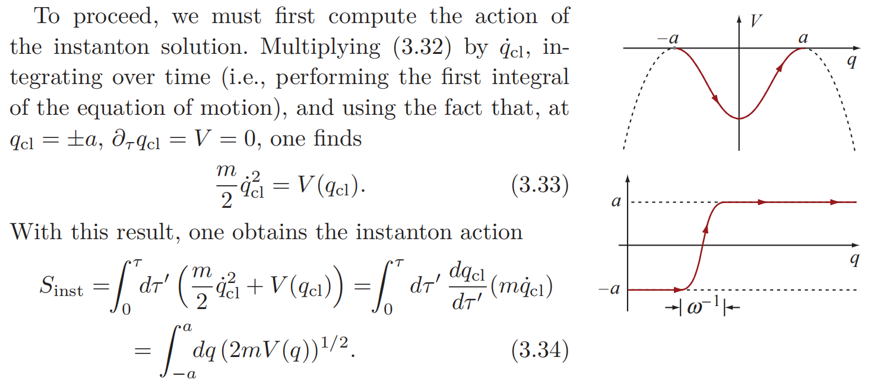
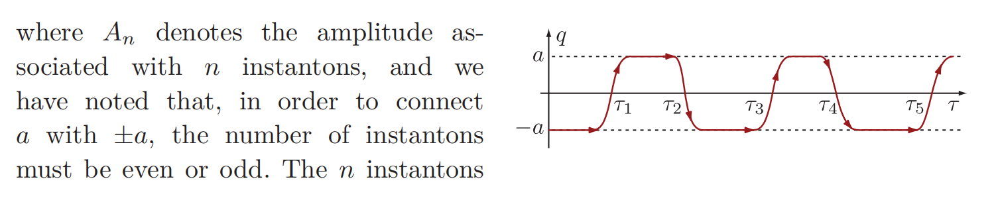

一些路径积分的进阶理论，虽然偏冷门知识但感觉挺有意思所以就随便写写

---

## 1 / 路径积分的近似理论

首先，一维的鞍点近似告诉我们，对于下面类型的积分

$$
I(\hbar)=\int_{-\infty}^{\infty}
dx\,g(x)e^{-f(x)/\hbar}
$$

如果能找到 $f(x)$ 在 $x_0$ 处具有非退化的局部极小值

$$
f'(x_0)=0,\qquad f''(x_0)>0
$$

则有近似

$$
I(\hbar)\approx
e^{-f(x_0)/\hbar}
\sqrt{\frac{2\pi\hbar}{f''(x_0)}} g(x_0)
$$

存在多个贡献相近的鞍点那就是

$$
I(\hbar)\sim
\sum_{\alpha}
e^{-f(x_\alpha)/\hbar}
\sqrt{\frac{2\pi\hbar}{f''(x_\alpha)}} g(x_\alpha)
$$

这个结论可以扩展到高维，很自然的想法是把二阶导 $f''(x_\alpha)$ 替换成对应点的Hessian 

$$
I_d(N)=\int_{\mathbb R^d}e^{-f(\mathbf x)/\epsilon}
g(\mathbf x)\,d^d x
$$

$$
I_d(N)\approx
g(\mathbf x_*)e^{-f(\mathbf x_*)/\epsilon}
\left(2\pi \epsilon\right)^{d/2}
\frac1{\sqrt{\det H}}
$$

这个想法倒没什么大问题，对于单一的局部最值是可行的。问题出现在高维时可能有多个函数值一样的极值点，例如函数

$$
f(x,y)=(x^2+y^2-a^2)^2,\qquad a>0
$$

其鞍点不是孤立的，而是构成一个连续流形（Morse–Bott 型临界流形）。换个说法就是Hessian存在零特征值的方向。这个时候需要人为地把这一方向剔除。

当然这个例子可以用极坐标变换轻松解决，我们还是希望找一个更普适的方法。

一般地，设$f$ 在一个光滑、紧致的 $d$ 维流形 $\mathcal M$ 上达到相同的全局极小值 $f_0$。

$$
I(\varepsilon)
=
\int_{\mathbb R^N}d^Nx\,
e^{-f(\mathbf x)/\varepsilon}
$$

可以在这个流形附近选取局部坐标 $\mathbf x=\mathbf x(\boldsymbol\alpha,\boldsymbol\eta)$，其中 $\boldsymbol\alpha=(\alpha_1,\ldots,\alpha_d)$ 描述沿鞍点流形的方向， $\boldsymbol\eta=(\eta_1,\ldots,\eta_{N-d})$ 描述垂直于鞍点流形的方向。假设 Hessian 在全部法向方向上正定，于是可以展开为

$$
f(\boldsymbol\alpha,\boldsymbol\eta)
=
f_0+
\frac12\boldsymbol\eta^T
H_\perp(\boldsymbol\alpha)\boldsymbol\eta
+O(\|\boldsymbol\eta\|^3)
$$

积分于是分为流形空间的积分和法向空间的积分

$$
I(\varepsilon)
\sim
e^{-f_0/\varepsilon}
\int_{\mathcal M}d\mathrm{vol}_{\mathcal M}
\int_{\mathbb R^{N-d}}d^{N-d}\eta\,
e^{-\frac1{2\varepsilon}\eta^TH_\perp\eta}
$$

$$
I(\varepsilon)\sim
e^{-f_0/\varepsilon}
(2\pi\varepsilon)^{(N-d)/2}
\int_{\mathcal M}
\frac{d\mathrm{vol}_{\mathcal M}}
{\sqrt{\det H_\perp(\mathbf x)}}
$$

路径积分实质就是无穷维空间的积分，只不过把无穷维的点写成了路径的形式。自己其实一直觉得路径积分理论有符号滥用的嫌疑，anyway，把路径积分视作高维空间的积分有助于接下来的理解

采用欧式路径积分（进行 $t=-i\tau$ 代换就能变成实时间的路径积分）

$$
K_E(x_f,\tau;x_i,0)
=
\int_{x(0)=x_i}^{x(\tau)=x_f}
\mathcal Dx\,
e^{-S_E[x]/\hbar}
$$

$$
S_E[x]
=
\int d\tau
\left[
\frac m2\left(\frac{dx}{d\tau}\right)^2
+V(x)
\right]
$$

大多路径积分都是很难做的，只有二次型和一些特殊体系可以精确求解。所以照搬前面的鞍点近似理论，假设泛函存在多个驻点（也就是轨道） $x_{\mathrm{cl}}^{(1)}(\tau),
x_{\mathrm{cl}}^{(2)}(\tau),\ldots$，满足

$$
\left.
\frac{\delta S_E}{\delta x(\tau)}
\right|_{x=x_{\mathrm{cl}}^{(\alpha)}}=0
$$

驻点附近进行展开

$$
x(\tau)=x_{\mathrm{cl}}^{(\alpha)}(\tau)+\eta(\tau)
$$

$$
S_E[x]
=
S_E[x_{\mathrm{cl}}^{(\alpha)}]
+
\frac12\langle\eta,\hat K_\alpha\eta\rangle
+O(\eta^3)
$$

Hessian矩阵变算符

$$
\hat K_\alpha
=
-m\frac{d^2}{d\tau^2}
+
V''(x_{\mathrm{cl}}^{(\alpha)}(\tau))
$$

好消息是保留到二阶的话积分就是可做的，得到结果

$$
K_E
\sim
\sum_{\alpha}
\mathcal N_\alpha
\frac{e^{-S_E[x_{\mathrm{cl}}^{(\alpha)}]/\hbar}}
{\sqrt{\det\hat K_\alpha}}
$$

看上去非常完美，如果在谐振子上做这个结果就是完全精确的，因为谐振子没有更高次项，所以为了提升挑战性就不妨看看下面这个模型

## 2 / 双势阱与瞬子

考虑双势阱

$$
V(x)=\frac{\lambda}{4}(x^2-a^2)^2
$$

$$
S_E[x]=\int d\tau
\left[
\frac m2\dot x^2+\frac{\lambda}{4}(x^2-a^2)^2
\right]
$$

试图像波函数理论一样来分析能级，事实上路径积分分析能级和波函数的确不如波函数理论直接，但不妨碍我们理论上能做到这件事，引入正则配分函数

$$
Z(\beta)=\operatorname{Tr}e^{-\beta H}
$$

由谱分解，如果哈密顿量能够量子化，那么应该有能量本征基底下的

$$
Z(\beta)=\sum_ne^{-\beta E_n}
$$

另一方面，注意到位置本征基底下

$$
Z(\beta)
=
\int_{-\infty}^{\infty}dx\,
\langle x|e^{-HT/\hbar}|x\rangle
=
\int_{-\infty}^{\infty}dx\,
K_E(x,\beta\hbar;x,0)
$$

$$
T=\beta\hbar
$$

相当于对所有首尾相接的路径积分，也就是周期欧氏路径积分

$$
Z(\beta)
=
\int_{x(0)=x(\beta\hbar)}
\mathcal Dx\,e^{-S_E[x]/\hbar}
$$

就拿双势阱来分析，先找驻点，EL方程给出（满足边界条件$x(0) = x(T)$）

$$
\left.
\frac{\delta S_E}{\delta x(\tau)}
\right|_{x=x_{\mathrm{cl}}^{(\alpha)}}=0
$$

$$
m\ddot x=\lambda x(x^2-a^2)
$$

其实一眼能看出两个最显然的驻点，也即常数路径

$$
x(\tau)=a
$$

$$
x(\tau)=-a
$$

不妨只在这两个驻点处先展开看看，例如左侧驻点

$$
V(-a+q)
=
\lambda a^2q^2-\lambda aq^3+\frac{\lambda}{4}q^4 \approx\frac12m\omega^2q^2
$$

$$
\omega=\sqrt{\frac{2\lambda a^2}{m}}
$$

解出

$$
Z_L^{(0)}(\beta)
=
\frac1{2\sinh(\beta\hbar\omega/2)}
$$

同样右侧

$$
Z_R^{(0)}(\beta)
=
\frac1{2\sinh(\beta\hbar\omega/2)}
$$

得到了个谐振子能级

$$
Z_{\mathrm{no\ inst}}(\beta)
\approx Z_L^{(0)}+Z_R^{(0)}
=
\frac2{2\sinh(\beta\hbar\omega/2)}
\approx
2\sum_{n=0}^{\infty}
e^{-\beta\hbar\omega(n+1/2)}
$$

$$
\begin{aligned}
E_{0,L}^{\mathrm{loc}}&=E_{0,R}^{\mathrm{loc}}\approx\frac12\hbar\omega\\
E_{1,L}^{\mathrm{loc}}&=E_{1,R}^{\mathrm{loc}}\approx\frac32\hbar\omega\\
&\vdots
\end{aligned}
$$

所以一番近似之后双势阱被搞成两个独立谐振子了。显然是过度近似导致的。

原因也很直接，那就是驻点轨道其实不止这两个常数解，尽管它们的确最显然而且作用量最小（严谨一点，欧式作用量）。但看起来其他驻点还没到可以全部忽略的地步。

先换个边界条件，来看看满足$x(-\infty)=-a,x(\infty)=a$的传播子，相同的EL方程给出不同的解

$$
x_I(\tau;\tau_0)=
a\tanh\left[\frac{\omega}{2}(\tau-\tau_1)\right]
$$

这里称之为瞬子解。类似的有反瞬子

$$
x_{\bar I}(\tau;\tau_2)=
-a\tanh\left[\frac{\omega}{2}(\tau-\tau_2)\right]
$$

构造这俩的原因是，容易看出，一个瞬子—反瞬子对构造出来的解可以近似满足EL方程，也就是驻点条件

或者说由其构造的任意偶数次跃迁

但会发现到，例如2次跃迁的瞬子-反瞬子对，其存在两个自由参数$\tau_1$ & $\tau_2$，换言之其Hessian存在零模方向，必须用前面提到的分解空间方式处理。

假设一条周期路径包含 $2k$ 次跃迁，其中心位置为

$$
0<\tau_1<\tau_2<\cdots<\tau_{2k}<T
$$

单瞬子作用量严格解为

$$
S_I=\frac23m\omega a^2
$$

那么我们构造出来的瞬子对解应该有

$$
S_{2k}\approx2kS_I
$$

剩下的令人比较在意的问题就是，我们一开始的要求是所有首尾相连的路径中寻找驻点，而不是预先要求路径从 $-a$ 出发并返回 $-a$，或者从 $+a$ 出发并返回 $+a$。所以比较自然的问题是，为什么我们有理由相信，计算双势阱的能级劈裂时，只需考虑孤立瞬子及其多瞬子组合，而不会遗漏其他可能同样重要的非平凡路径。

这个问题比较合理的解释是，我们选取$2k$次跃迁的瞬子对解不是因为它们的作用量最小，而是因为它们的集体贡献不可忽略。而对于双势阱来说只有真空之间的跃迁存在这种集体结构。

当然作为更直接的数值验证，可以用WKB方法

---
**References**

[1] *Condensed Matter Field Theory* (Alexander Altland, Ben Simons)

[2] *路径积分与量子物理导引* (侯伯元, 云国宏, 杨战营) 