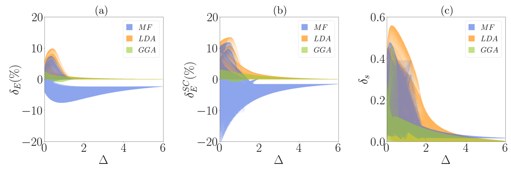
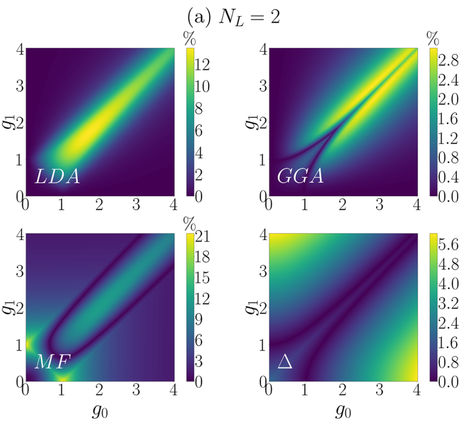
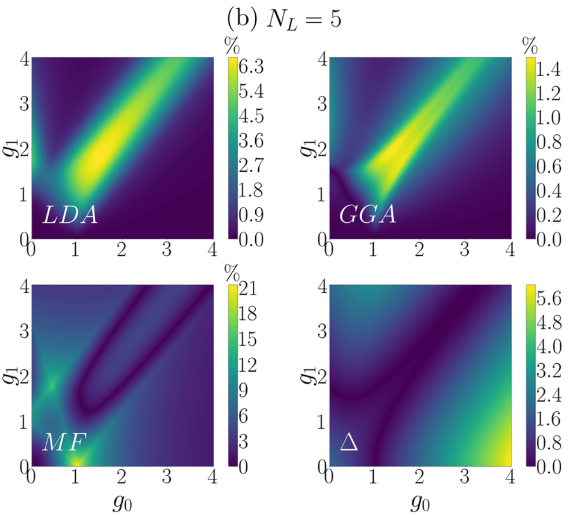
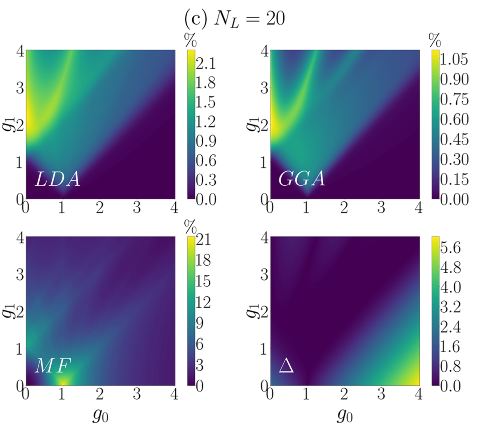
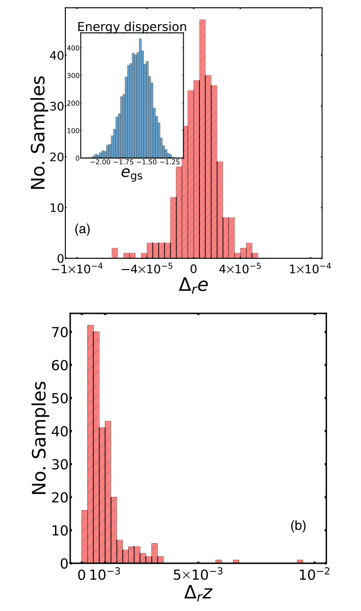
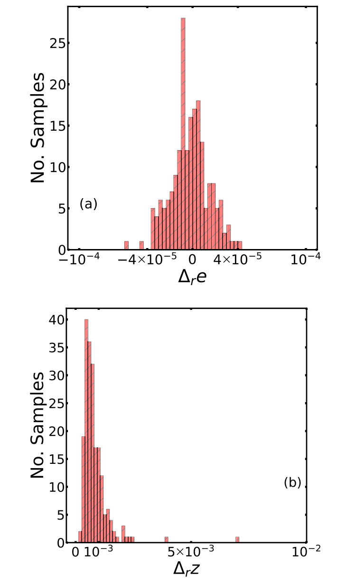
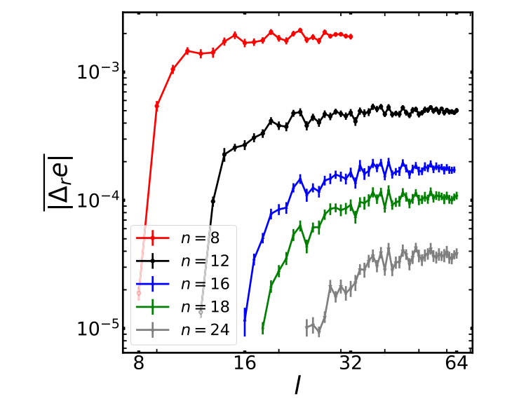

本文为参考文献[@mao_testing_2021; @costa_deep_2023; @cronin_machine_2025]的阅读笔记。

## 1 / Quantum Ising Model

文献[@mao_testing_2021; @costa_deep_2023]采用相同的横场Ising模型，其中[@mao_testing_2021]这一篇图表相对直观，这里先拿这篇进行分析。

首先由于横场Ising模型本身是自旋模型，没法定义密度的泛函，由此这里是以自旋分布$\boldsymbol\sigma^x=\{\sigma_i^x\}$作为等效密度。类似的能够定义广义的DFT理论，得到相应自旋形式下的LDA和GGA泛函。

> 文献[@mao_testing_2021; @cronin_machine_2025]中分别在transverse Ising model和1D Hubbard model中定义DFT的方式值得借鉴，之后的笔记会再详细分析。

另外无论横场是否是均匀场，横场Ising模型都是严格可解模型，意味着我们可以将不同参数配置下得到的结果与泛函自洽结果进行比较。

不同参数指的是横场的调节，具体来说我们把横场定义成两个可调参数的形式。

$$
g_i=g_0+g_1\cos\left(\frac{2\pi i}{N_L}\right).
\tag{14}
$$

调节参数计算不同能隙$\Delta$下精确解与泛函解的误差

$$
\delta_E=
\frac{E_{\mathrm{tot}}^{\mathrm{DFT}}-E_{\mathrm{tot}}^{\mathrm{exact}}}
{E_{\mathrm{tot}}^{\mathrm{exact}}}.
\tag{17}
$$

$$
\delta_s=
\sqrt{\frac{1}{N_L}\sum_{i=1}^{N_L}
\left(\sigma_i^{x,\mathrm{DFT}}-
\sigma_i^{x,\mathrm{exact}}\right)^2}.
\tag{18}
$$

fig1中图一为精确密度代入近似能量泛函后与精确能量的误差，图二为自洽密度代入泛函后与精确能量的误差。

显而易见的，越靠近能隙$\Delta$为0的临界处，局域/半局域泛函的可靠性越差。

具体做出$g_0,g_1$的分布，可以更细致地观察参数的影响，当然结论是没什么变化的。

能隙与局域性之间的物理联系或许可以这样理解，在固定的有隙相内，关联通常随距离衰减，有限邻域更有机会提供足够信息；靠近临界点时，长距离关联变得重要，只读取一个点或一条键的信息就可能不足。

## 2 / Machine Learning Method

文献[@costa_deep_2023; @cronin_machine_2025]采用机器学习的思路得到相似的结果。相比起采用LDA或GGA，机器学习的思路是直接根据构形的精确解的数据集，经过学习后得到一个形式上的泛函。并将其运用在未训练的数据集上。

横场Ising就是直接理论的精确求解，1D Hubbard的数据来源于iDMRG，也可认为是精确数据。

当然神经网络什么的设计逻辑不是我们所在意的，这里真正对我们有启发性的认知是，我们可以通过限制泛函的学习区间，然后比较不同区间下泛函的有效性，来间接得到泛函的局域/非局域性质。

理论上，即使是机器学习的泛函，也应该符合先前的结论，也即越靠近临界点附近，泛函的有效性越差。以文献[@costa_deep_2023]为例，其定义了三种误差，分别对应最终能量、磁化分布以及在正确输入上泛函本身的正确性。

$$
\overline{\Delta_r e}
=\frac1{N_{\mathrm{ts}}}\sum_{a=1}^{N_{\mathrm{ts}}}
\frac{e_{\mathrm{gs}}^{(a)}-e_{\min}^{(a)}}{e_{\mathrm{gs}}^{(a)}}.
\tag{11}
$$

$$
\overline{\Delta_r z}
=\frac1{N_{\mathrm{ts}}}\sum_{a=1}^{N_{\mathrm{ts}}}
\frac{\|\mathbf z_{\mathrm{gs}}^{(a)}-\mathbf z_{\min}^{(a)}\|_1}
{\|\mathbf z_{\mathrm{gs}}^{(a)}\|_1}.
\tag{12}
$$

$$
\Delta_r u=
\frac{\sum_i f_i[\mathbf z_{\mathrm{gs}}]-u}{u},
\qquad u=\langle\hat U\rangle_{\mathrm{gs}}.
\tag{D9}
$$

fig5和fig6分别对应最近邻Ising和次近邻Ising两个模型。

符合直觉的，局域性强（也就也是学习区间窄）的泛函，其在临界点附近区间的表现应该明显弱于半局域泛函，且应该存在单调的依赖关系。fig7中 $l$ 表示训练链长度。显然的，增大训练链长能够降低我们关心的误差尺度。

文献中还试图拟合训练长度与误差的经验幂律，但这个操作得出来的指数与量子临界对应的指数的关系并不清晰，这里就不过多讨论。

> 或许理论上的确存在一个类似泛函截断长度的量？值得进一步的思考。

文献[@cronin_machine_2025]中也有类似结果，不多赘述。